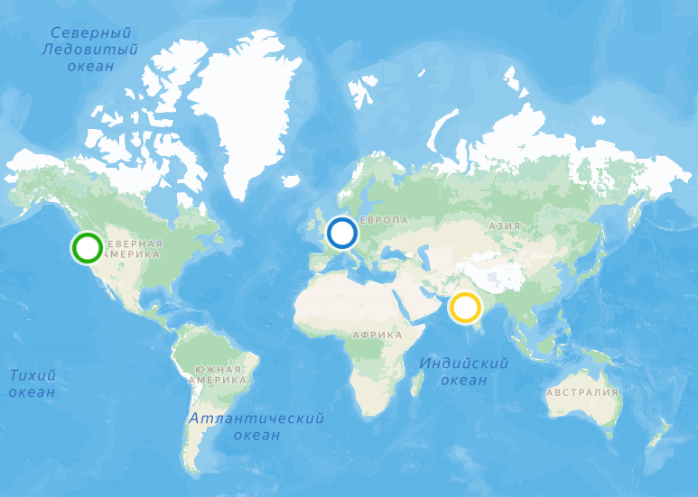
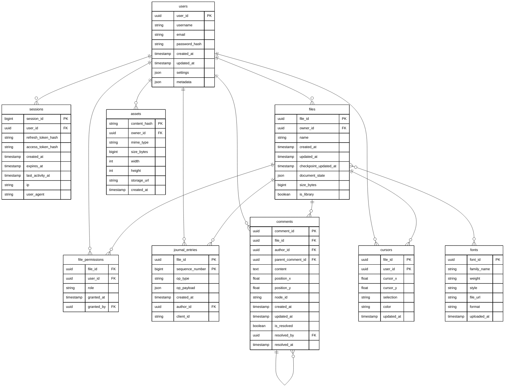
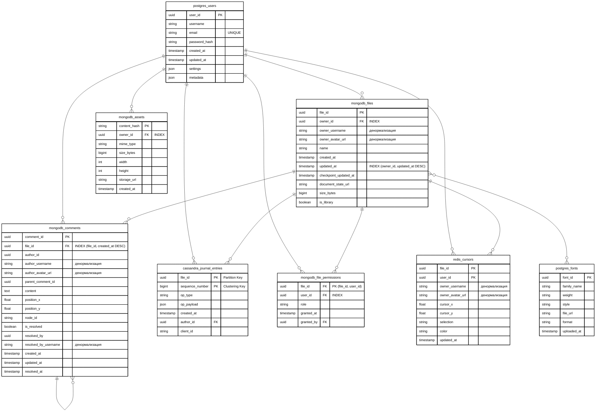
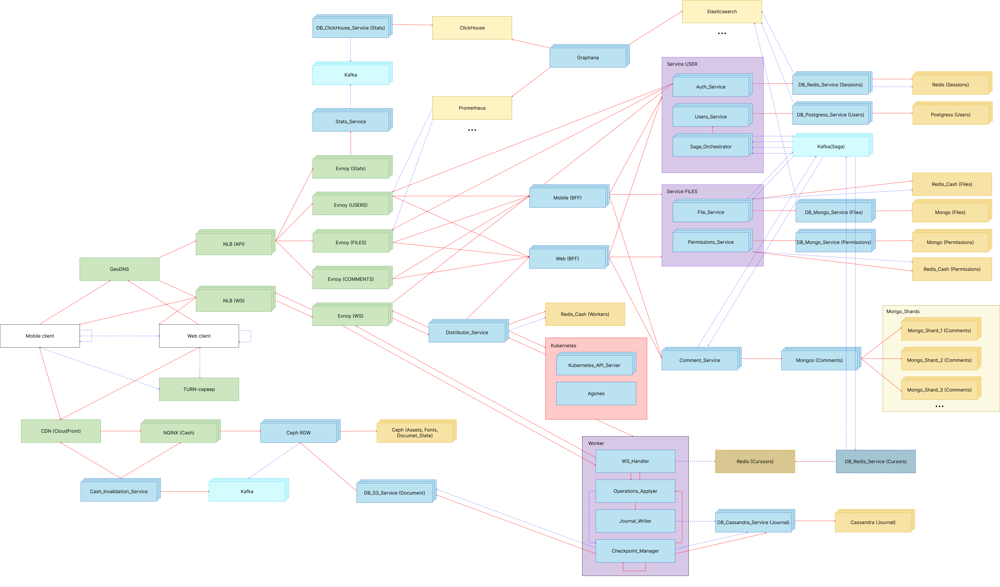

# Расчётно-пояснительная записка: VK Education High-load

## 1. Тема и целевая аудитория

[Figma](https://www.figma.com) - это один из самых популярных облачных графических редакторов, которым пользуются не только профессиональные дизайнеры, но и обычные пользователи. (В том числе я сам его использую для проектирования различных схем)

### Ключевой функционал

* Создание и редактрование объектов векторной графики
* Сохранение макета в облаке с выбором формата(PNG, JPEG, SVG, PDF)
* Просмотр сохранённого макета
* Совместная работа над одним макетом с видимостью курсоров
* Создание комментариев
* Регистрация пользователей
* Авторизация пользователей

### Ключевые продуктовые решения

* Совместная работа через WebSocket
* Передача полученных в ходе сессии изменений в макете, вместо полного документа

### Целевая аудитория

Согласно отчёту S-1[^1] , по состоянию на март 2025 года Figma имеет 13 млн активных пользователей в месяц и более 10 млн индивидуальных пользователей. Этим сервисом пользуется большое количество крупных компаний, среди них стоит отметить Microsoft, Airbnb, Github и Uber.

Основной аудиторией Figma являются дизайнеры, разработчик, продакт-менеджеры, исследователи и маркетологи. Большая часть клиентской базы находится в США - 38% и в Индии - 7%. Это говорит о том, что сервис активно используется по всему миру.

С точки зрения размеров организаций, основную долю пользовательской базы составляют компании с численностью сотрудников <50 человек - на них приходит 44% аудитории, на предприятия со штатом от 100 до 1000 сотрудников - 42%, а на крупные корпорации - 13%.

## 2. Расчёт нагрузки

К сожалению, Figma не предоставляет большинство необходимой для аналитики метрик информации в своих отчётах. Поэтому для большинства характеристик цифры были получены в качестве усреднения результатов схожих по сфере проектов на рынке и информации от дизайнеров пользовавшимся этим сервисом для реализации своих задач.

### Продуктовые метрики

#### Аудитория

Данные для рассчета DAU были получены за счёт того, что согласно аналитике Signals&Stories[^2]  проекты B2B SaaS в Северной Америке в среднем имеют показатель коэффициента удержания 31%, а в Азиатско-Тихоокеанском регионе - 33%. Согласно отчёту Figma и их заявлениям большинство пользователей сервиса пирходятся на США и на Индию. Поэтому в качестве значения DAU было выбрано число равное 4 млн пользователей.

| Метрика | Значение |
|---------|----------|
| MAU | 13 млн |
| DAU | 4 млн |
| MAU/DAU | 32% |

>**Вычисление:** DAU = MAU × среднее(31%, 33%) = 13 млн × 32% = 4,16 млн ~ 4 млн

#### Данные

##### Файлы

Из общения с дизайнером, который имел стаж 2 года, было выяввлено, что в своей работе он использует более 100 файлов в Figma. В своём отчете компания заявила, что около 2/3 пользователей не является дизайнерами, а также одну треть от пользователей составляют разработчики. К сожалению, точно оценить количество файлов для разработчиков и остальных типов пользователей не удалось, поэтому воспользуемся очень условной оценкой: определённо разработчики создают кратно меньше файлов, по сравнению с дизайнерами, но при этом явно создают больше чем простые пользователи, так что предположим, что этот показатель можно оценить в диапазоне 15-20; по остальным типам пользователям практически невозможно сказать, поэтому возьмём условную оценку в 5-10 файлов. В итоге, предположив, что среднее количество файлов для всех дизайнеров будет равно 100, а остальный показатели будут соответствовать выдвинутым оценкам получим среднее число - 40-43 файла на пользователя. Учитывая неточность данных (и повышая количество файлов для большей нагруженности сервиса) возьмём в качестве среднего показателя 50.

> **Вычисление:** (100 × 1/3) + (17,5 × 1/3) + (7,5 × 1/3) = 33,3 + 5,8 + 2,5 ~ 41,6 => 40–43 файла. Для нагрузки взято 50.

По поводу размера файлов не получилось получить точное число от дизайнера: "сложно оценить, так как файлов много и где-то лежит 1 объект, а где-то файл с дизайном для очень крупного события". В силу этого придётся отталкиваться только от информации о том, что максимальный размер файла составляет 2 ГБ и найденного исследования[^3], затрагивающего тему размера файлов. Из них было выявлено, что размеры варьируются от 28 до 41 МБ, но учитывая, что файлы в исследовании относились к дизайну приложений следует, что по всем пользователям оценка будет явно ниже: 10-30 МБ. Далее воспользуемся средней оценкой в 20 МБ.

В итоге получаем, что для пользователя средний размер всех фалов составляет приблизительно 1ГБ.

> **Вычисление:** 50 файлов × 20 МБ = 1000 МБ = 1 ГБ.

##### Журналы файлов

В Figma довольно сложная система хранения версий файлов, но для данного MVP воспользуемся упрощённой версией. Каждые 0.5 секунд система делает сохранение дельта-изменений в файле в журнал, а каждые 30 минут создаёт чекпоинт, который собирает все накопленные в журнале изменения и применяет их к прошлому чекпоинту. Тем самым, для каждого файла пользователя необходимо хранить дополнительную информацию о журнале изменений применённых после последнего чекпоинта. Согласно официальному блогу Figma[^4], инкрементальные изменения «на порядки меньше» полного файла. Учитывая, что за 30 минут может произойти максимум 3600 изменени, среди которых в стандартном случае работы лишь меньшая часть будет содержать реальные изменения, можно предположить, что средний размер журнала для файла будет составлять 1-3% от его размера. Точно оценить данный показатель без полноценных исследований просто невозможно, поэтому данное число было выбрано на основе логичных предположений.

> **Вычисление:** за 30 минут максимум 30 × 60 / 0,5 = 3600 записей. Реальных изменений - меньшая часть, поэтому журнал = 1–3% от файла. Для файла 20 МБ: 0,2–0,6 МБ. На пользователя (50 файлов): 50 × 0,4 МБ ~ 0,02 ГБ.

##### Комментарии

Комментарии в Figma не хранятся внутри файла, а в отдельном месте, поэтому их стоит рассчитать как отдельный пункт. Со слов дизайнера в его команде не часто пользуется комментариями и он оставляет в среднем от 0 до 5 комментариев в неделю. С учётом того, что в среднем активных файлов будет 1-5, по словам дизайнера, то есть в среднем 3, то за неделю будет получено около 1 комментария на файл. Учитывая, что по оценке дизайнера в среднем файл для дизайна активен в течении 3 месяцев, получаем что среднее количсевто комментариев - 13 на файл. Данная оценка ещё не учитывала оставшихся 2/3 пользователей. Разработчики определённо пользуются комментарии, по моему предположению настолько же активно как и дизайнеры, поэтому применим к ним ту же оценку. По остальным типам пользователей почтии ничего не известно, так что используя предложенное соотношения для файлов к комментариям получим, что они оставляют в среднем 1 комментарий на файл. В итоге среднее количество комментариев для пользователя - 1350/3 ~ 450 комментариев. Учитывая служебные поля комментариев и среднюю оценку длинны сообщения в 250 символов получим[^5], что их средний размер стоит ограничить 0,5 КБ. Таким образом, средний размер комментариев - 450*0,5=225КБ что меньше 0.001 ГБ.

> **Вычисление:** дизайнер: 0–5 комм/нед, при 3 активных файлах => ~1 комм/файл/нед. За 3 месяца (13 недель): 13 комм/файл. Дизайнеры: 650 комм/польз. Разработчики: 650 комм/польз. Остальные: 50 комм/польз. Средневзвешенное: (650 + 650 + 50) / 3 ~ 450 комм/польз. Размер: 450 × 0,5 КБ = 225 КБ < 0,001 ГБ.

##### Пользовательские данные

Согласно  Privacy FAQ Figma[^6], в системе хранятся только метаданные профиля и служебная информация. Поэтому будем учитывать, что для пользователя будет достаточно хранить данный набор: имя профиля, email, хеш праоля, настройки и метаднные. Имя пользователя в среднем имеет размер 12 байт, а email - 23 байта[^7], для хранения хэша понадобится 64 байта (SHA-512). Для того чтобы сохранить эту информацию вместе с метаданными и настройками пользователя будет достаточно 1КБ.

##### Сводная таблица

| Тип данных | Средний размер(шт.) | Средний размер(ГБ) |
|---------|----------|----------|
| Файлы | 50 | 1 |
| Журналы файлов | 50 | 0.02 |
| Комментарии | 450 | <0.001 |
| Пользовательские данные | 1 | <0.001 |
| **Итого** | 551 | **~1,02** |

#### Картина пользователя

В итоге всех измерений была получена следующая картина пользователя Figma.

| Тип пользователя | Доля | Файлов на пользователя | Комментариев на файл | Комментариев на пользователя |
|------------------|------|------------------------|----------------------|------------------------------|
| Дизайнеры | 1/3 | 100 | 13 | 650 |
| Разработчики | 1/3 | 15–20 | 13 | 650 |
| Остальные | 1/3 | 5–10 | 1 | 50 |
| **Средневзвешенное** | **1** | **~50** | **~9** | **~450** |

#### Действия пользователей

- **Регистрация** - происходит 1 раз за всё время, так что таких запросов почти не будет.

- **Аутентификация** - по сути является отражением сессий пользователя, так что их количество можно оценить тем, сколько в среднем пользователи создают сессий в день. Согласно данному источнику для проектов типа B2B SaaS это число колеблется от 3 до 5[^8], так что возьмём среднее число - 4.

- **Открытие файла** - данное значение довольно сложно оценить, неизвестно, сколько различных файлов в течение одной сессии может открыть стандартный пользователь. Опираясь на предположенную выше информацию в 3 активных файла у пользователя, можем предположить, что за 1 сессию пользователь в среднем открывает 3 файла. Это значение очень условно и мало чем подтверждено, но получить конкретные цифры мне не удалось.

- **Создание и редактирование объектов** - это ещё более непредсказуемое и сложно оцениваемое значение. Дизайнеру было тяжело оценить это значение, получить информацию в интернете невозможно, значения этого показателя для других 2 типов пользователей ещё более туманны. Было найдено значение в 100000 вставок в месяц[^9], но количество сотрудников в компании неизвестно, и это только создание объектов, без учёта редактирования. Просто предлагаю взять число в 300–500 операций в день.

- **Записи в журнал** - согласно найденному блогу[^10] можно оценить, что дизайнер проводит в Figma в среднем по 4 часа в день, то есть максимум будет сделано примерно 30000 записей в журнал, но с учётом того, что оставшиеся 2/3 пользователей проводят меньше времени в системе, а также не всё это время в файле будут появляться изменения, уменьшим данный показатель до 4000–5000 запросов в день.

- **Сохранение изменений** - происходит каждые полчаса работы в файле, а также при закрытии сессии. Опираясь на оценку в 4 часа в день в Figma для дизайнера, получим, что он сделает в среднем 8+4=12 сохранений за день. Учитывая оставшиеся 2/3 пользователей, уменьшим эту оценку до 6–8 сохранений в день.

- **Синхронизация через WebSocket** - в официальном блоге Figma указано, что клиент при совместной работе отправляет сообщение раз в 33 мс. Опираясь на оценку в 4 часа в день для дизайнеров, получим, что должно отправиться около 436000 сообщений. Но, учитывая, что изменения не происходят большую часть времени, и многие запросы батчатся для оптимизации, эта оценка сильно завышена. Более логичное число - это 10% от этого показателя. Осталось учесть оставшиеся 2/3 пользователей - они уменьшат оценку до значения в 25000 запросов в день.

- **Создание комментариев** - воспользуемся теми числами, которые были указаны в расчёте количества комментариев для пользователя, оценка получилась довольно низкая - 0.5 запросов в день.

- **Просмотр комментариев** - это действие, в отличие от создания, происходит в разы чаще, поэтому стоит эту оценку поднять до 5 запросов в день. Коэффициент 10 был подобран вследствие следующей статьи[^11].

- **Экспорт файлов** - опираясь на слова дизайнера, данный функционал используется довольно редко, и в его случае применялся в среднем пару раз в неделю, что говорит о том, что таких запросов для среднего пользователя будет очень мало. Будем использовать значение 1/8, так как 2/3 пользователей будут пользоваться данной функцией реже, чем дизайнеры, и понизят оценку до 2/7 запросов в день.

##### Сводная таблица

| Тип действия | Запросов/день |
|--------------|---------------|
| Регистрация | 1 (за всё время) |
| Аутентификация | 4 |
| Открытие файла | 12 |
| Создание и редактирование объектов | 300–500 |
| Записи в журнал | 4000–5000 |
| Сохранение изменений | 6–8 |
| Синхронизация через WebSocket | 25000 |
| Создание комментариев | 0.5 |
| Просмотр комментариев | 5 |
| Экспорт файлов | 0.125 |
| **Итого (без учёта WebSocket)** | **~4330–5030** |

### Технические метрики

#### Хранение по типам данных

 Для того, чтобы рассчитать размер хранилища необходимо знать какое количество пользоваетелей имеет приложение. Figma не расскрывала эти данные ни в каких документах, поэтому лучшей оценкой, которую можно использовать будет MAU - 13 млн пользователей. Таким образом получим, что размер всех данных будет составлять около 13,3 ПБ, что вполне может отражать реальные показатели сервиса.

| Тип данных | Средний размер(шт.) | Средний размер |
|---------|----------|----------|
| Файлы | 650 млн | 13 ПБ |
| Журналы файлов | 650 млн | 0,26 ПБ |
| Комментарии | 5,85 млрд | 3 ТБ |
| Пользовательские данные | 13 млн | 13 ГБ |
| **Итого** | - | **~13,27 ПБ** |

##### Сетевой трафик

Для того, чтобы оценить сетевой трафик Figma необходимо рассчитать сколько в среднем будет весить каждый запрос для определённого типа действия.

- **Регистрация пользователя** - данное действие включает в себя отправку пользователем email, имени пользователя и пароля на сервер и ответ сервера с токеном и профилем. Учитываыя, что вся информация о пользователе входит в 1 КБ, а для отправки запросов потребуется установить соединение (типично 6453 байта[^12]) и проставить несколько дополнительных заголовков в запрос (типично 700-800 байт[^13]), можно оценить, что в среднем данное действие потребует около 8-9 КБ.

- **Аунтификация пользователя** - это действие почти идентично регистрации по своим показателям, так что размер такого запроса можно также оценить в 8-9 КБ

- **Открытие файла** - при открытии файла Figma загружает не весь документ целиком, а только его структуру: узлы, фреймы, слои, текст и журнал изменений. Изображения, шрифты и компоненты из библиотек не входят в этот запрос - они хранятся отдельно и подгружаются по мере необходимости. Поэтому размер операции уменьшается с 20,5 МБ до ~5,5–10,5 МБ.

- **Создание и редактирование объектов** - данная операция по сути представляет собой отображение на клиенте применённых изменения и не создаёт сетевого трафика.

- **Записи в журнал** - аналогично созданию и редактированию объектов, только происходит на стороне сервера и не создаёт сетевого трафика.

- **Сохранение изменений** - данное действие включает в себе применение изменений журнала к сохраненной версии фалйа и целиком происходит на сервере, так что не создаёт сетевого трафика.

- **Синхронищация через WebSocket** - при этой операции на сервер отправляется батч измененний, который произошёл на клиенте за короткий промежуток времени. Среди информации может также быть положение других пользователей в файле, но вместе с информацией о группе дельт они не будут занимать иного места, так как по сути будет список из преобразований в несколько байт и список координат с именами пользователей тоже на несколько байт. По итогу, с учётом оптимизаций формата данных можно взять оченку в 0,5-1 КБ на запрос.

- **Создание комментариев** - данная операция передаёт на сервер комментарий, длинна которого выше была оценена 250 символами в среднем, с заголовками на сервер. Используя оценки приведённые в других пунктах получим, что сообщение будет иметь размер около 1 КБ.

- **Просмотр комментариев** - для данного действия придётся получить от сервера все комментарии в файле. По оценкам, приведённым ранне получаем, что необходимо в среднем отправить 9 комментариев на файл. Учитывая метаданные комментариев, заголовки запроса и средний размер сообщения как при создании получаем, что для отравки потребуется 10 КБ.

- **Экспорт файлов** - эта опреация потребует скачивание файла в определённом формате по сети и именно оно будет составлять основную нагрузку. В качестве оценки среднего результат алгоритма сжатия файла, приименяющегося для конвертации данных возьмём 60%, что в итоге даёт 6-7 МБ на запрос.

Для получения итоговых результатов возьмём количество запросов по типу в день из прошлых оценок и DAU приложения. Домножим размер запроса на эти значения и получим следующие результаты, отражающие средний трафик в день по типам запроса:

| Тип действия | Трафик/день |
|--------------|----------------------------|
| Регистрация | ~34 ГБ |
| Аутентификация | ~136 ГБ |
| Открытие файла | ~499 ТБ |
| Синхронизация через WebSocket | ~75 ТБ |
| Создание комментариев | ~2 ГБ |
| Просмотр комментариев | ~200 ГБ |
| Экспорт файлов | ~3,2 ТБ |
| **Итого** | **~577 ТБ** |

> **Вычисления:**
> - Регистрация: 4 млн × 8,5 КБ ~ 34 ГБ
> - Аутентификация: 4 млн × 4 × 8,5 КБ ~ 136 ГБ
> - Открытие файла: 4 млн × 12 × 10,4 МБ ~ 499 ТБ
> - WebSocket: 4 млн × 25000 × 0,75 КБ ~ 75 ТБ
> - Создание комментариев: 4 млн × 0,5 × 1 КБ ~ 2 ГБ
> - Просмотр комментариев: 4 млн × 5 × 10 КБ ~ 200 ГБ
> - Экспорт: 4 млн × 0,125 × 6,5 МБ ~ 3,2 ТБ
> - **Итого: ~577 ТБ**

Чтобы оценить пиковую нагрузку на сеть необходимо получить распределение пользователей и оценить размер пиков с учётом их расположения. Figma нигде не гооврит о конкретных цифрах распределения пользователя но утвержлает, что большая часть аудитории приходится на США и Индию. Чтобы более точно оценить воспользуемся Similarweb[^14], источник не советовали использовать, но для этой цели, как мне кажется, подойдёт. Получаем следующую картину:

| Страна | Доля трафика | Пользователей (от 4 млн DAU) | Часовой пояс |
|--------|--------------|-------------------------------|--------------|
| США | 16,09% | ~644 тыс. | UTC−5 … UTC−8 |
| Индия | 10,76% | ~430 тыс. | UTC+5:30 |
| Россия | 8,08% | ~323 тыс. | UTC+3 … UTC+12 |
| Китай | 3,97% | ~159 тыс. | UTC+8 |
| ЕС | ~15-20% | ~600–800 тыс. | UTC+0 |
| Остальные | ~35–45% | ~1400–1800 тыс. | Разные |

Из данного распределения видно, что нагрузка в течении дня будет достаточно равномерной, так что крупных пиков не будет наблюдаться. Возьмём в качестве коэффициента для расчёта пиковой нагрзки 2, что можно взять исходя из данного исследования[^15], рассматривающего различные показатели приложения, использующегося по всему миру. Тогда разделив среднии показатели нагрузки в течении дня на его длину и умножив на коэффициент получим следующие результаты:

| Тип трафика | Средняя нагрузка (Гбит/с) | Пиковая нагрузка (Гбит/с) |
|-------------|---------------------------|---------------------------|
| Регистрация | ~0,003 | ~0,006 |
| Аутентификация | ~0,013 | ~0,026 |
| Открытие файла | ~46,2 | ~92,4 |
| Синхронизация через WebSocket | ~6,9 | ~13,8 |
| Создание комментариев | ~0,0002 | ~0,0004 |
| Просмотр комментариев | ~0,019 | ~0,038 |
| Экспорт файлов | ~0,3 | ~0,6 |
| **Итого** | **~53,4** | **~106,8** |

#### RPS запросов

RPS рассчитан как количество запросов в день на всех пользователях (4 млн DAU), делённое на 86 400 секунд. Пиковый RPS - умножением среднего на коэффициент 2, аналогично как для рассчёта пиковой нагрузки.

| Тип запроса | RPS (средний) | RPS (пиковый) |
|-------------|---------------|---------------|
| Регистрация | ~0,05 | ~0,1 |
| Аутентификация | ~185 | ~370 |
| Открытие файла | ~556 | ~1 112 |
| Синхронизация через WebSocket (новые соединения) | ~185 | ~370 |
| Создание комментариев | ~23 | ~46 |
| Просмотр комментариев | ~231 | ~462 |
| Экспорт файлов | ~6 | ~12 |
| **Итого** | **~1 186 (~13 686 с WS-сообщениями)** | **~2 372 (~27 372 с WS-сообщениями)** |

> **Вычисления:**
> - Регистрация: 4 млн × 1 / 86 400 ~ 0,05
> - Аутентификация: 4 млн × 4 / 86 400 ~ 185
> - Открытие файла: 4 млн × 12 / 86 400 ~ 556
> - WebSocket (новые соединения): 4 млн × 4 / 86 400 ~ 185
> - Создание комментариев: 4 млн × 0,5 / 86 400 ~ 23
> - Просмотр комментариев: 4 млн × 5 / 86 400 ~ 231
> - Экспорт файлов: 4 млн × 0,125 / 86 400 ~ 6
> - **Итого (без WS-сообщений): ~1 186 RPS (средний), ~2 372 RPS (пиковый)**
> - WS-сообщения: 4 млн × 25 000 / 86 400 ~ 1 157 407 в день на всех пользователях, но с учётом батчинга и неодновременной активности пиковый RPS = 25 000 => **~12 500 средний / ~25 000 пиковый**
> - **Итого (с WS-сообщениями): ~13 686 RPS (средний), ~27 372 RPS (пиковый)**

## 3. Глобальная балансировка нагрузки

Figma использует инфраструктуру Amazon Web Services (AWS) для размещения своих данных. Официально подтверждённые регионы для локального хостинга данных перечислены в документации Figma[^16].

| Регион | Основной дата-центр | Резервный дата-центр (Disaster Recovery) |
|--------|---------------------|------------------------------------------|
| США  | us-west-2 (Орегон) | us-east-1 (Вирджиния) |
| ЕС | eu-central-1 (Франкфурт) | eu-west-1 (Дублин) |
| Австралия | ap-southeast-2 (Сидней) | ap-southeast-4 (Мельбурн) |
| Индия | ap-south-1 (Мумбаи) | ap-south-2 (Хайдарабад) |
| Бразилия | sa-east-1 (Сан-Паулу) | - | 
| Япония | ap-northeast-1 (Токио) | ap-northeast-3 (Осака) |
| Канада | ca-central-1 | ca-west-1 | 

Для MVP боольшая часть из них не понадобится, поэтому остановимся на 3, которые будут покрывать основные рынки(США, Европа, Индия): 

| Дата-центр | Локация | Тип |Доля нагрузки |
|------------|---------|-----|--------------|
| США | us-west-2 (Орегон) | Дата-центр | ~35% |
| Европа | eu-central-1 (Франкфурт) | Дата-центр | ~35% |
| Индия | ap-south-1 (Мумбаи) | Дата-центр |~30% |

### США - Орегон (us-west-2)
Дата-центр расположен на западном побережье США, в штате Орегон. Выбран потому, что США - крупнейший рынок по трафику (16,09%), а Орегон - зрелый регион AWS с четырьмя зонами доступности, что обеспечивает высокую отказоустойчивость внутри самого дата-центра. Помимо Северной Америки, этот дата-центр покрывает Южную Америку (Бразилия, Аргентина, Чили и др.) и часть Юго-Восточной Азии, не имеющих собственного дата-центра. Доля нагрузки - ~30%, так как США дают 16,09%, а остальное приходится на покрываемые регионы.

### Европа - Франкфурт (eu-central-1)
Дата-центр расположен в Германии, в городе Франкфурт. Выбран потому, что Европа - большой по значимости регион, а Франкфурт - основной хаб AWS в Европе с тремя зонами доступности. Помимо стран ЕС, этот дата-центр покрывает Россию, Ближний Восток (ОАЭ, Саудовская Аравия, Израиль) и Северную Африку. Доля нагрузки - ~35%, что соответствует сумме долей ЕС (15–20%), России (8,08%) и покрываемых регионов.

### Индия - Мумбаи (ap-south-1)
Дата-центр расположен на западном побережье Индии, в городе Мумбаи. Выбран потому, что Индия - второй по величине рынок Figma после США по активным пользователям, а Мумбаи - основной хаб AWS в Южной Азии с тремя зонами доступности. Помимо Индии, этот дата-центр покрывает Китай, Японию, Южную Корею, Юго-Восточную Азию (Сингапур, Индонезия, Вьетнам и др.) и Австралию. Доля нагрузки - ~35%, что соответствует сумме долей Индии (10,76%), Китая (3,97%) и покрываемых регионов.

Для распределения пользователей между дата-центрами может использоватся latency-based routing в Amazon Route 53[^17] или просто Geo-DNS. Первый метод направляет запрос пользователя в тот регион, который обеспечивает наименьшую сетевую задержку, на основе измерений AWS между сетью пользователя и дата-центрами, но его пока не так часто используют крупнве компании. Второй метод уже давно проверен, им пользуется большое количество компаний, в том числе и сама Figma, и задержки к которым он может привести по сравнению с первым будут незначительны.

> **Отдельная информация по поводу работы latency-based** 
> Latency-based распределение работает на основе заранее собранной статистики, а не измерения задержки в момент запроса. Фоновые «пингеры» (LatencyProbe) постоянно зондируют целевые серверы из разных точек и замеряют RTT, привязывая результаты к группам DNS-резолверов. Эти данные формируют таблицу задержек, которая обновляется с заданным интервалом.
> Когда пользователь делает запрос, его браузер обращается к рекурсивному DNS-резолверу, а уже тот - к авторитетному DNS системы балансировки. Система видит IP-адрес резолвера, а не клиента, и ищет в таблице, какой сервер быстрее всего именно для этого резолвера (или для сети пользователя, если резолвер передаёт EDNS Client Subnet). На основе этой статистики система возвращает резолверу IP-адрес оптимального сервера, который тот передаёт пользователю.

## 4. Локальная балансировка нагрузки

Перед тем как проектировать систему локальной нагрузки была продумана схема, по которой будет осуществляться обработка основных типов взаимодействия пользователя и системы. Основной пункт касался того, как построить правильное совместное взаимодействие пользователей по WS с одним файлом. В качестве решения было принято использовать привязку файла к конкретному Multiplayer-инстансу через consistent hash по fileId: все клиенты, открывшие один файл, попадают на один и тот же инстанс, который держит состояние этого файла в памяти и рассылает операции всем подключённым клиентам. Это исключает split brain - ситуацию, когда разные инстансы независимо применяют операции к одной и той же копии файла и расходятся в состоянии. Было также рассмотрено решение через репликацию инстансов файла на все датацентры и поддержку синхронности через CRDT, но это очень тяжёлая задача и не требуется для такой системы (такое решение приняла и сама Figma). У такого подхода есть один минус, с которым придётся смириться, пользователи, которые находятся в отличном от расположения Multiplayer-инстанса регионе получат большую задержку[^18].

Далее для распределения локальной нагрузки нужно посмотреть как могут обрабатываться основные запросы сервиса:

- **Регистрация** - обрабатывается как обычный API-запрос, без привязки к файлу, любым API-инстансом.

- **Аутентификация** - обрабатывается так же, как регистрация: любой API-инстанс, без привязки к файлу.

- **Открытие файла** - обрабатывается как API-запрос любым API-инстансом (манифест читается из хранилища). Отдельно от этого клиент открывает WebSocket, который уже привязывается к конкретному Multiplayer-инстансу по fileId.

- **Создание и редактирование объектов** - отдельно не маршрутизируется, передаётся внутри WebSocket-канала.

- **Записи в журнал** - отдельно не маршрутизируется, выполняется на Multiplayer-инстансе, владеющем файлом.

- **Сохранение изменений** - отдельно не маршрутизируется, выполняется на Multiplayer-инстансе или фоновом воркере.

- **Синхронизация через WebSocket** - маршрутизируется строго по fileId через consistent hash на конкретный Multiplayer-инстанс. Соединение открывается при любом редактировании, независимо от числа пользователей.

- **Создание комментариев** - обрабатывается как API-запрос любым API-инстансом, без привязки к Multiplayer.

- **Просмотр комментариев** - обрабатывается как API-запрос любым API-инстансом, без привязки.

- **Экспорт файлов** - обрабатывается как API-запрос, выполняется асинхронно через очередь задач и воркер, результат кладётся в хранилище.

- **Внутренние запросы за статикой (шрифты, иконки, UI-ассеты, компоненты библиотек)** - маршрутизируются через CDN, без задействования L4 и L7. Сюда же относятся запросы за изображениями, загруженными пользователем: они тоже идут через CDN, origin - S3

Теперь можно ввести уже полноценное описание того, как можно организовать распределение локальной нагрузки. Общая схема строится на разделении трафика по трём маршрутам, каждый из которых обслуживается своим набором компонентов.

**Первый маршрут** - статика и бинарные ассеты. Запросы за шрифтами, иконками, UI-ассетами, компонентами библиотек, а также за изображениями, загруженными пользователем, идут через CDN. Эти ресурсы вынесены на отдельное доменное имя, например static.figma.com, которое резолвится в адреса CDN. За счёт этого DNS ещё на этапе резолва отличает запрос за статикой от запросов к API или WebSocket и направляет его в нужный маршрут. Клиент обращается к DNS, получает адрес ближайшего edge-узла и забирает контент оттуда; origin'ом выступает S3, который нагружается только при cache miss. L4 и L7 в этом маршруте не задействованы, потому что ресурсы не требуют состояния и привязки.

**Второй маршрут** - API-запросы. Путь запроса начинается с глобального DNS: он определяет ближайший к пользователю дата-центр и возвращает один виртуальный IP (VIP), за которым стоит пул L4-инстансов в этом дата-центре. Все L4-инстансы анонсируют этот VIP через BGP, а вышестоящий коммутатор строит ECMP-группу и распределяет входящие TCP-потоки между L4 по хешу от five-tuple. Это значит, что клиент всегда видит один адрес и не выбирает L4 сам, а распределение между L4 делает сеть. Если один L4 падает, он перестаёт анонсировать VIP, коммутатор убирает его из ECMP-группы, и трафик автоматически идёт на оставшиеся - без участия DNS и клиента.

Дальше L4 работает в режиме passthrough и распределяет TCP-соединения между L7-инстансами по алгоритму Least Connections: новое соединение идёт на тот L7, у которого сейчас меньше всего активных соединений. Это даёт более равномерную загрузку, чем Round Robin, потому что учитывает реальную текущую нагрузку на каждый L7. Выбранный L7 терминирует TLS и маршрутизирует запрос на любой API-инстанс - по Round Robin, так как API-инстансы stateless и все равнозначны. API-инстансы читают и пишут в общее хранилище, поэтому привязка к конкретному инстансу не нужна. Регистрация, аутентификация, открытие файла, комментарии и экспорт идут именно по этому маршруту. Экспорт при этом уходит в очередь задач и обрабатывается фоновым воркером асинхронно.

**Третий маршрут** - WebSocket-соединения. Путь запроса также начинается с глобального DNS: он определяет ближайший дата-центр и возвращает тот же VIP, за которым стоит пул L4-инстансов в этом дата-центре. Распределение между L4 работает так же, как во втором маршруте: все L4 анонсируют VIP через BGP, коммутатор строит ECMP-группу и распределяет потоки по хешу от five-tuple. Клиент снова видит один адрес и не выбирает L4 сам.

Выбранный L4 по Consistent Hash (был архитектурный косяк с Least Connections, так как при такой реализации каждый L7 должен знать ВСЕ воркеры файлов, что противоречет логике, так как правильнее дать каждому L7 ограниченное число воркеров за которые он ответственнен) на основе хэша от fileId отправляет запрос на тот L7, который содержит в своём хэш-кольце воркер, отвечающий за этот файл. Выбранный L7 терминирует TLS и применяет другую логику, чем для API: он извлекает fileId из URL, cookie или subprotocol, считает consistent hash и направляет соединение на конкретный Multiplayer-инстанс, который владеет этим файлом. Все клиенты одного файла попадают на один и тот же инстанс, что исключает split brain. Создание и редактирование объектов, записи в журнал и сохранение изменений отдельно не маршрутизируются - они происходят внутри этого WS-канала и на этом же инстансе.

#### Модификации для безопасности

Трафик между клиентом и L7 защищён TLS, который терминируется на L7. Трафик между L4 и L7 идёт внутри VPC, но для защиты от прослушивания внутри дата-центра его стоит закрыть mTLS: L4 предъявляет клиентский сертификат, L7 его проверяет. Это не требует изменения логики приложения и не нагружает L4 криптографией - L4 только инициирует соединение как клиент, а расшифровка и проверка сертификатов происходят на L7. Такой подход соответствует принципам Zero Trust и применяется в service mesh в проде.

#### Модификации для отказоустойчивости

Отказ Multiplayer-инстанса. L7 при маршрутизации WebSocket-соединения вместо одного конкретного инстанса возвращает клиенту список инстансов, владеющих файлом, - основной и один-два резервных, полученных из consistent hash-кольца. Клиент пытается подключиться к основному, и если тот не отвечает, переходит к следующему. Резервный инстанс подгружает последний checkpoint и journal из хранилища и продолжает обслуживать файл. Дополнительно L7 использует health-check'и: если основной инстанс не отвечает, он сразу направляет новые соединения на резервный.

Отказ L7-инстанса. L7 stateless относительно маршрутизации для запросов отличных от работы с файлом, поэтому потеря отдельного L7 не приводит к потере данных. L4 по Least Connections просто перестаёт направлять на него новые соединения, а клиенты переподключаются к оставшимся L7. А вот в случае запросов, связанных с работой с фалйлом, L7 stateful, поэтому для одной группы файлов есть несколько L7, находящиеся в одном кольце и имеющие доступ к ним. В случае падения одного из них запросы перейдут к следующему узлу L7 в кольце.

Отказ L4-инстанса. Все L4 анонсируют VIP через BGP и входят в ECMP-группу. При падении одного L4 он перестаёт анонсировать VIP, коммутатор убирает его из группы, и трафик автоматически идёт на оставшиеся. L4 не хранит состояние, поэтому потеря инстанса не приводит к потере данных.

Отказ зоны целиком. Поскольку файл привязан к конкретному Multiplayer-инстансу в одном дата-центре, падение зоны означает, что все файлы, владельцы которых были в ней, становятся недоступны до восстановления дата-центра или переназначения владельцев на инстансы в других зонах. Резервные инстансы находятся в том же дата-центре, поэтому они спасают от отказа отдельного сервера, но не от отказа зоны. Эта проблема без потерь в других аспектах организации в сети не разрешима, так что с ней придётся смирится.

После того как определены роли уровней и требования к ним, нужно выбрать конкретные реализации. Для L4 был выбран AWS Network Load Balancer, для L7 - Envoy.

**NLB:** Ключевое требование к L4 в этой схеме - держать долгоживущие TCP-соединения, не разрывая их, и при этом не тратить ресурсы на разбор содержимого. NLB работает на транспортном уровне и не парсит HTTP, поэтому его пропускная способность и задержка не зависят от сложности прикладного протокола. Его дефолтный idle timeout - 350 секунд, тогда как у ALB и HAProxy - 60 секунд: для WebSocket-сессий, которые могут жить часами, это принципиально.

**Envoy:** Был выбран из-за того, что обновляет список Multiplayer-инстансов и позиции на хеш-кольце без перезапуска процесса и без разрыва уже установленных соединений. В схеме с consistent hash по fileId это важно: когда инстанс добавляется или падает, конфигурация на всех L7 должна обновиться синхронно, не порождая при этом новых процессов и не сбрасывая долгие WebSocket-сессии. HAProxy при изменении конфига требует перезагрузки, а старые процессы продолжают держать соединения, что создаёт операционную нагрузку и мешает быстрой сходимости. Дополнительно Envoy даёт ring hash для consistent hash по fileId и поддержку mTLS, что закрывает требования и по маршрутизации, и по безопасности между L4 и L7.

Резервирование на всех уровнях считается по формуле N+1, где N - число инстансов, необходимых для обработки пиковой нагрузки, а +1 - резервный инстанс на случай отказа одного из рабочих. Формула: N_total = N_required + 1, где N_required = ceil(пиковая нагрузка / пропускная способность одного инстанса).

#### Расчёт L4

Ограничители для L4 - пропускная способность и количество соединений. AWS не публикует фиксированную пропускную способность на «инстанс» NLB, потому что сервис автоматически масштабируется. Вместо этого используется модель LCU (Load Balancer Capacity Unit), где одна LCU эквивалентна 2,2 Мбит/с обработанного трафика .

Через L4 проходит трафик API и WebSocket: 92,4 + 13,8 = 106,2 Гбит/с. По пропускной способности требуется 106 200 / 2,2 ~ 48273 LCU. По умолчанию на одну зону доступности можно зарезервировать до 45000 LCU[^19], поэтому одной зоны недостаточно - нагрузка распределяется на две зоны с запасом. С учётом резервирования по формуле N+1 требуется 3 зоны доступности с зарезервированными LCU в каждой. При трёх дата-центрах - 9 зон доступности суммарно.

#### Расчёт L7

Ограничители для L7 - SSL Termination и пропускная способность сети. По SSL Termination: один Envoy-инстанс на 8 vCPU выдерживает порядка 10000–15000 новых TLS-соединений в секунду и до 50 Гбит/с расшифрованного трафика[^20]. Возьмём консервативно 10000 соединений/с и 25 Гбит/с на инстанс. По соединениям: пиковый RPS из раздела 2 - 2 372, это значительно меньше возможностей одного инстанса, поэтому по соединениям достаточно одного. По пропускной способности: 106,2 / 25 = 4,25, ceil = 5. N_required = max(1, 5) = 5. N_total = 5 + 1 = 6 L7-инстансов на дата-центр. С учётом трёх дата-центров - 18 L7-инстансов.

## 5. Логическая схема БД

### Схема таблиц баз данных

> Потом схему переделаю в Figma

### Описание таблиц

- **users** - хранит профиль пользователя: имя, email, хеш пароля, настройки и метаданные. Необходима для аутентификации и авторизации. Информацию, которую тяжело представить одним полем (настройки и метаданные) были представлены в виде JSON-файлов. Пароль хранится в виде хеша, с зашифрованной внутри солью.

- **sessions** - хранит активные сессии и токены: refresh-токен, access-токен, время жизни, IP, user-agent. Нужна, чтобы не требовать повторного ввода пароля на каждый запрос и чтобы пользователь мог видеть и отзывать свои активные сессии. Сессия переживает перезапуск API-инстансов.

- **files** -  хранит метаданные файла (имя, владелец, размер, флаг библиотеки) и ссылку на снапшот документа в S3, где лежит `document_state`. Это снапшот, который создаётся при процессе сохранении. Вместе с `journal_entries` используется для получения самого актуального состояние файла. Для того, чтобы добавить хранение историй изменений можно вынести отдельную сущность в виде checkpoint, но в рамках данного MVP я его не подразумевал (и не зря).

- **file_permissions** - матрица доступа к файлу, которая используется для определения, кто и с какой ролью (owner/editor/viewer) может работать с файлом. Такое решение было выбрано в связи с тем, что доступ к работе с файлом осуществляется не просто с помощью передачи ссылки, а благодаря приглашениям от владельца файла определённым пользователям.

- **journal_entries** - журнал изменений после последнего снапшота, хранящий последовательность операций (`op_type`, `op_payload`) в пределах одного файла. По нему файл доводится до актуального состояния при процессе синхронизации. `client_id` позволяет различать соединения одного пользователя и корректно обрабатывать переподключения и дедупликацию, а `author_id` показывает какой пользователь вносиил изменения.
 
- **comments** - комментарии к файлу: текст, автор, треды (через `parent_comment_id`), позиция на холсте (`position_x`, `position_y`, `node_id`), статус решения. Хранятся отдельно от дерева документа, опираясь на аналогичное продуктовое решение Figma, которое тоже не локализует комментарии вместе с файлом и они расположены в отдельных таблицах. 

- **assets** - метаданные загруженных изображений. Первичный ключ - хеш содержимого (`content_hash`), что даёт дедупликацию: одна картинка хранится один раз, независимо от того, кто её загрузил. Сами бинарные данные лежат в S3, в БД только метаданные и ссылка. Связь с файлами - через ссылки внутри `document_state`, а не через отдельную таблицу, потому что ассет - глобальный ресурс, а не часть файла.

- **fonts** - метаданные загруженных шрифтов: family, weight, style, формат, ссылка на файл в S3.

- **cursors** - хранит положение курсоров пользователей в файле: координаты (`cursor_x`, `cursor_y`), выделение, цвет, время последнего обновления. Составной ключ `(file_id, user_id)` гарантирует, что у одного пользователя в одном файле только один курсор.

> **Пояснения:**
> Отдельно стоит сказать, что не вынесено в сущности. Геометрические примитивы, стили, текст, пути, компоненты, переменные, и связи - всё это внутри `document_state` в `files`, потому что документ - это иерархическое дерево, а не набор нормализованных строк. Вынос их в отдельные таблицы ломает атомарность снапшота и усложняет синхронизацию через журнал. Библиотеки - это файлы с флагом `is_library`, отдельная таблица не нужна. 

### Рассчёт размеров таблиц

- **files** - хранит метаданные файла (имя, владелец, размер, флаг библиотеки), без `document_state`, который вынесен в S3. Среднее количество файлов на пользователя - 50, всего при 13 млн MAU - 650 млн файлов. Средний размер строки складывается из: `file_id` (UUID, 16 Б), `owner_id` (UUID, 16 Б), `name` (~30 Б), `created_at` (8 Б), `updated_at` (8 Б), `checkpoint_updated_at` (8 Б), `size_bytes` (8 Б), `is_library` (1 Б) = 95 Б. Итоговый размер таблицы: 650 млн × 95 Б ~ 61,8 ГБ.

> **Вычисление:** 16 + 16 + 30 + 8 + 8 + 8 + 8 + 1 = 95 Б. 650 млн × 95 Б = 61 750 000 000 Б ~ 61,8 ГБ.

- **journal_entries** - журнал изменений после последнего снапшота, хранящий последовательность операций в пределах одного файла. Средний размер журнала для файла - 1–3% от его размера, для файла 20 МБ это 0,2–0,6 МБ. При 650 млн файлов и среднем размере журнала 0,4 МБ итоговый объём - 0,26 ПБ. Средний размер одной записи складывается из: `file_id` (16 Б), `sequence_number` (8 Б), `op_type` (10 Б), `op_payload` (~200 Б), `author_id` (16 Б), `client_id` (16 Б), `created_at` (8 Б), = 274 Б.

> **Вычисление:** 16 + 8 + 10 + 200 + 16 + 16 + 8 = 274 Б. Всего: 650 млн × 0,3 МБ ~ 0,2 ПБ.

- **comments** - комментарии к файлу: текст, автор, позиция на холсте, статус решения. Среднее количество комментариев на пользователя - 450. Средний размер комментария - 0,5 КБ. Всего при 13 млн MAU - 5,85 млрд комментариев. Средний размер строки складывается из: `comment_id` (UUID, 16 Б), `file_id` (UUID, 16 Б), `author_id` (UUID, 16 Б), `parent_comment_id` (UUID, 16 Б), `content` (~250 Б), `position_x` (4 Б), `position_y` (4 Б), `node_id` (~20 Б), `created_at` (8 Б), `updated_at` (8 Б), `is_resolved` (1 Б), `resolved_by` (UUID, 16 Б), `resolved_at` (8 Б) = 383 Б. Итоговый размер таблицы: 5,85 млрд × 383 Б ~ 2,24 ТБ.

> **Вычисление:** Из оценки выше среднее количество комментариев на полбзователя ~ 450 комм/польз. Размер строки: 16 + 16 + 16 + 16 + 250 + 4 + 4 + 20 + 8 + 8 + 1 + 16 + 8 = 383 Б. Всего: 13 млн × 450 × 383 Б = 5,85 млрд × 383 Б ~ 2,24 ТБ.

- **users** - профиль пользователя: имя, email, хеш пароля, настройки и метаданные. Всего пользователей - 13 млн (MAU). Средний размер строки складывается из: `user_id` (UUID, 16 Б), `username` (~12 Б), `email` (~23 Б), `password_hash` (64 Б), `created_at` (8 Б), `updated_at` (8 Б), `settings` (JSONB, ~200 Б), `metadata` (JSONB, ~200 Б) = 531 Б. Итоговый размер таблицы: 13 млн × 531 Б ~ 6,9 ГБ.

> **Вычисление:** 16 + 12 + 23 + 64 + 8 + 8 + 200 + 200 = 531 Б. 13 млн × 531 Б ~ 6,9 ГБ.

- **sessions** - активные сессии и токены: refresh-токен, access-токен, время жизни, IP, user-agent. В среднем 4 сессии на пользователя, как указано выше, всего 52 млн сессий. Средний размер строки складывается из: `session_id` (BigInt, 8 Б), `user_id` (UUID, 16 Б), `refresh_token_hash` (64 Б), `access_token_hash` (64 Б), `created_at` (8 Б), `expires_at` (8 Б), `last_activity_at` (8 Б), `ip` (~15 Б), `user_agent` (~120 Б) = 311 Б. Итоговый размер таблицы: 52 млн × 311 Б ~ 15 ГБ.

> **Вычисление:** 8 + 16 + 64 + 64 + 8 + 8 + 8 + 15 + 120 = 311 Б. 39 млн × 311 Б ~ 12,1 ГБ.

- **file_permissions** - матрица доступа к файлу: кто и с какой ролью может работать с файлом. По данным Figma, среднее число людей, совместно работающее над одним файлом - 4 человека и около 52% файлов являются совместными. Оценка количества записей: 650 млн × 0,52 ~ 338 млн совместных файлов × 4 приглашённых ~ 1,35 млрд, плюс 650 млн × 0,48 ~ 312 млн файлов только с владельцем - итого ~1,66 млрд записей. Средний размер строки складывается из: `file_id` (UUID, 16 Б), `user_id` (UUID, 16 Б), `role` (~10 Б), `granted_at` (8 Б), `granted_by` (UUID, 16 Б) = 66 Б.

> **Вычисление:** 16 + 16 + 10 + 8 + 16 = 66 Б. 1,66 млрд × 66 Б ~ 109,6 ГБ.

- **assets** - метаданные загруженных изображений: хеш содержимого, MIME-тип, размеры, ссылка на S3. Сами бинарные данные лежат в S3 и раздаются через CDN, в таблице остаются только метаданные и ссылка (`storage_url`). Прямой статистики по среднему количеству уникальных изображений в файле Figma нет. Для расчёта с запасом принято допущение: 10% файлов содержат изображения, и в среднем на такой файл приходится 20 уникальных изображений. Итого 650 млн × 0,1 × 20 = 1,3 млрд ассетов. Средний размер строки складывается из: `content_hash` (64 Б), `owner_id` (UUID, 16 Б), `mime_type` (~20 Б), `size_bytes` (8 Б), `width` (4 Б), `height` (4 Б), `storage_url` (~100 Б), `created_at` (8 Б) = 224 Б.

> **Вычисление:** 64 + 16 + 20 + 8 + 4 + 4 + 100 + 8 = 224 Б. 650 млн × 0,1 × 20 = 1,3 млрд × 224 Б ~ 291 ГБ

- **fonts** - метаданные доступных шрифтов: family, weight, style, формат, ссылка на файл. В Figma доступна библиотека Google Fonts - около 2000 шрифтов (в разных источниках 1000–1850). Возьмём 2000 как верхнюю оценку. Средний размер строки складывается из: `font_id` (UUID, 16 Б), `family_name` (~20 Б), `weight` (~10 Б), `style` (~10 Б), `file_url` (~100 Б), `format` (~5 Б), `uploaded_at` (8 Б) = 169 Б.

> **Вычисление:** 16 + 20 + 10 + 10 + 100 + 5 + 8 = 169 Б. 2000 × 169 Б ~ 0,3 МБ

- **cursors** - хранит положение курсоров пользователей в файле: координаты, выделение, цвет, время обновления. По данным Figma, в одном файле отображается не более 200 курсоров, а среднее число пользователей - 4 человека. Для расчёта с запасом принято допущение: 4 млн DAU × 10% одновременно работающих = 400 000 пользователей, и у каждого файла в этот момент активны 4 пользователя. Итого 400 000 × 4 = 1,6 млн записей. Средний размер строки складывается из: `file_id` (UUID, 16 Б), `user_id` (UUID, 16 Б), `cursor_x` (4 Б), `cursor_y` (4 Б), `selection` (~50 Б), `color` (~7 Б), `updated_at` (8 Б) = 105 Б.

> **Вычисление:** 16 + 16 + 4 + 4 + 50 + 7 + 8 = 105 Б. 400 000 пользователей × 4 курсора = 1,6 млн записей × 105 Б ~ 168 МБ.

### Итоговая таблица размеров

| Таблица | Средний размер строки | Количество строк | Размер таблицы |
|---------|----------------------|------------------|----------------|
| users | ~531 Б | 13 млн | ~6,9 ГБ |
| sessions | ~311 Б | 52 млн | ~16,2 ГБ |
| files | ~95 Б | 650 млн | ~61,8 ГБ |
| file_permissions | ~66 Б | 1,66 млрд | ~109,6 ГБ |
| journal_entries | ~274 Б | 650 млн файлов × 0,3 МБ | ~0,2 ПБ |
| comments | ~383 Б | 5,85 млрд | ~2,24 ТБ |
| assets | ~224 Б | 1,3 млрд | ~291 ГБ |
| fonts | ~169 Б | 2000 | ~0,3 МБ |
| cursors | ~105 Б | 1,6 млн | ~168 МБ |

### Нагрузка на чтение и запись для таблиц

- **users** - чтение: 185 / 370 RPS (аутентификация); запись: 0,05 / 0,1 RPS (регистрация).

- **sessions** - чтение: ~1000–2000 RPS (проверка токена на каждом запросе, точного RPS нет, оценка от общего числа запросов); запись: 185 / 370 RPS (создание сессии при аутентификации).

- **files** - чтение: 556 / 1112 RPS (открытие файла); запись: 6 / 12 RPS (сохранение изменений, checkpoint).

- **file_permissions** - чтение: 556 / 1112 RPS (проверка прав при открытии файла); запись: ~1 / 2 RPS (выдача прав, точного RPS нет, оценка).

- **journal_entries** - чтение: 185 / 370 RPS (новые WS-соединения, reconnect); запись: ~200 / 400 RPS (записи в журнал батчами, точного RPS нет, оценка от 4000–5000 записей в день на пользователя).

- **comments** - чтение: 231 / 462 RPS (просмотр комментариев); запись: 23 / 46 RPS (создание комментариев).

- **assets** - чтение: ~50–100 RPS (проверка дедупликации, точного RPS нет, оценка); запись: ~10–20 RPS (загрузка изображений; точного RPS нет, оценка).

- **fonts** - чтение: ~10–20 RPS (справочник, точного RPS нет, оценка); запись: ~0,01 RPS (обновление каталога, точного RPS нет, оценка).

- **cursors** - запись: очень высокая, курсор обновляется при каждом движении мыши (десятки раз в секунду на активного пользователя). При 400000 одновременно работающих пользователей это миллионы операций записи в секунду; чтение: тоже очень высокое - каждое обновление рассылается всем участникам файла, поэтому на каждую запись приходится несколько чтений. Точных RPS нет, но и не требуется так как нагрузка очень высокая и на порядки выше, чем у остальных таблиц, этой информации будет достаточно для выбора СУБД.

### Итоговая таблица нагрузки

| Таблица | Чтение (средний / пиковый RPS) | Запись (средний / пиковый RPS) |
|---------|-------------------------------|-------------------------------|
| users | 185 / 370 | 0,05 / 0,1 |
| sessions | ~1000–2000 | 185 / 370 |
| files | 556 / 1112 | 6 / 12 |
| file_permissions | 556 / 1112 | ~1 / 2 |
| journal_entries | 185 / 370 | ~200 / 400 |
| comments | 231 / 462 | 23 / 46 |
| assets | ~50–100 | ~10–20 |
| fonts | ~10–20 | ~0,01 |
| cursors | очень высокая | очень высокая |

## 6. Физическая схема БД

В данной схеме comments, files, file_permissions и assets хранятся в MongoDB (шардирование по file_id для комментариев), PostgreSQL используется для users и fonts, а  journal_entries работает в Cassandra. Денормализация применяется там, где имя пользователя отображается в интерфейсе: owner_username в files, author_username в comments, resolved_by_username в comments. Это убирает JOIN с users на горячем пути чтения. Скорость работы выше на всех NoSQL-таблицах: чтение комментариев - один запрос к MongoDB по file_id без JOIN; список файлов пользователя - один запрос по owner_id с уже денормализованным owner_username; проверка прав - один запрос к file_permissios по (file_id, user_id); список участников файла - один запрос без JOIN. 
[Минусы решения: три СУБД вместо одной (PostgreSQL, MongoDB, Cassandra), асинхронная синхронизация денормализованных полей при смене имени (UPDATE в MongoDB через очередь) и отсутствие cross-СУБД транзакций.]

#### Общая схема

> Потом схему переделаю в Figma

#### Индексы

##### Таблица users

- **user_id** - PRIMARY KEY, B-Tree. Нужен для всех запросов, где пользователь ищется по ID: загрузка профиля, проверка владельца файла, JOIN с другими таблицами. B-Tree - стандарт для первичных ключей, обеспечивает O(log N) точечный поиск по уникальному UUID.
- **email** - UNIQUE, B-Tree. Нужен для входа в систему (поиск по email при аутентификации) и для защиты от дублей при регистрации. B-Tree гарантирует уникальность и обеспечивает точное совпадение по строке.

> **Вычисления:**
> - PK user_id (UUID, 16 Б): (16 + 32) × 13 млн ~ 0.6 ГБ
> - Unique email (String, ~30 Б): (30 + 32) × 13 млн ~ 0.8 ГБ
> - **Итого: ~1.4 ГБ**

##### Таблица sessions

- **session_id** - PRIMARY KEY, B-Tree. Нужен для прямого поиска сессии по ID: отзыв конкретной сессии, продление токена. B-Tree - стандарт для первичных ключей, точечный поиск по уникальному BigInt.
- **refresh_token_hash** - UNIQUE, B-Tree. Ключевой индекс для проверки токена на каждом запросе. Без него каждый запрос с токеном делал бы Full Table Scan по 52 млн строк. B-Tree обеспечивает уникальность и O(log N) поиск по хешу.
- **expires_at** - B-Tree. Нужен для очистки просроченных сессий фоновым воркером: DELETE WHERE expires_at < NOW(). B-Tree поддерживает диапазонные запросы по времени.

> **Вычисления:**
> - PK session_id (BigInt, 8 Б): (8 + 32) × 52 млн ~ 2.1 ГБ
> - Unique refresh_token_hash (Hash, 64 Б): (64 + 32) × 52 млн ~ 5.0 ГБ
> - Index expires_at (Timestamp, 8 Б): (8 + 32) × 52 млн ~ 2.1 ГБ
> - **Итого: ~9.2 ГБ**

##### Таблица files

- **file_id** - PRIMARY KEY, B-Tree. Нужен для открытия файла, проверки прав, JOIN с journal_entries и comments. Точечный поиск по уникальному ключу, B-Tree - стандарт для первичных ключей.
- **owner_id** - B-Tree. Нужен для запроса «все файлы пользователя». Точное совпадение по внешнему ключу, B-Tree оптимален для equality-запросов.
- **(owner_id, updated_at DESC)** - составной, B-Tree. Нужен для запроса «мои файлы, отсортированные по дате последнего изменения». Составной индекс покрывает и фильтр по owner_id, и сортировку по updated_at. Без него PostgreSQL делал бы отдельную сортировку (filesort) по 650 млн строк.

> **Вычисления:**
> - PK file_id (UUID, 16 Б): (16 + 32) × 650 млн ~ 31.2 ГБ
> - Index owner_id (UUID, 16 Б): (16 + 32) × 650 млн ~ 31.2 ГБ
> - Index (owner_id, updated_at DESC) (24 Б): (24 + 32) × 650 млн ~ 36.4 ГБ
> - **Итого: ~98.8 ГБ**

##### Таблица file_permissions

- **(file_id, user_id)** - PRIMARY KEY, составной B-Tree. Нужен для проверки прав: «может ли этот пользователь работать с этим файлом». Составной ключ гарантирует уникальность пары (файл, пользователь) и покрывает точечный поиск по двум полям. B-Tree оптимален для equality-запросов.
- **user_id** - B-Tree. Нужен для запроса «файлы, к которым у меня есть доступ». Без этого индекса пришлось бы сканировать всю таблицу из 1,66 млрд строк. B-Tree обеспечивает точное совпадение по внешнему ключу. Дублированием с PK не является, так как составной индекс (file_id, user_id) не может эффективно искать только по user_id (это вторая часть ключа).

> **Вычисления:**
> - PK (file_id, user_id) (32 Б): (32 + 32) × 1,66 млрд ~ 106.2 ГБ
> - Index user_id (UUID, 16 Б): (16 + 32) × 1,66 млрд ~ 79.7 ГБ
> - **Итого: ~185.9 ГБ**

##### Таблица journal_entries

Эта таблица хранится в column-family СУБД, а не в PostgreSQL, из-за экстремально высокой интенсивности записи (~20 млрд операций в день от всех DAU). В Cassandra индексы являются частью первичного ключа и физической структуры хранения - отдельных B-Tree индексов нет.

- **file_id** - Partition Key. Все записи одного файла физически находятся на одной ноде. Гарантирует, что при синхронизации после reconnect все операции файла читаются с одной ноды за один сетевой прыжок.
- **sequence_number** - Clustering Key. Записи внутри партиции отсортированы по номеру операции. Позволяет читать операции в хронологическом порядке без дополнительной сортировки и эффективно применять range-запросы.

> **Вычисления:**
> - В Cassandra нет отдельного «индекса» в классическом понимании - данные физически хранятся отсортированными по clustering key на диске (LSM-Tree). Размер хранения определяется размером самих данных и SSTable-индексами в памяти.
> - Средняя запись: file_id (16 Б) + sequence_number (8 Б) + op_type (10 Б) + op_payload (~200 Б) + author_id (16 Б) + client_id (16 Б) + created_at (8 Б) + накладные расходы Cassandra (~50 Б) ~ 324 байта
> - При нагрузке ~20 млрд записей в день и хранении за последние 30 дней: 600 млрд × 324 Б ~ ~194 ТБ распределённо по кластеру
> - В памяти каждой ноды держатся только key-cache и row-cache горячих файлов - типично 8–16 ГБ на ноду

##### Таблица comments

- **comment_id** - PRIMARY KEY, B-Tree. Нужен для прямого поиска комментария по ID: редактирование, удаление, реакции. Точечный поиск по уникальному ключу, B-Tree - стандарт.
- **(file_id, created_at DESC)** - составной, B-Tree. Нужен для получения ленты комментариев файла в хронологическом порядке. Покрывает и фильтр по файлу, и сортировку по времени. B-Tree позволяет читать первые N комментариев без полной выборки. Все комментарии файла загружаются одним запросом с пагинацией, клиент группирует их по parent_comment_id локально, поэтому отдельный индекс на parent_comment_id не нужен.

> **Вычисления:**
> - PK comment_id (UUID, 16 Б): (16 + 32) × 5,85 млрд ~ 280 ГБ
> - Index (file_id, created_at DESC) (24 Б): (24 + 32) × 5,85 млрд ~ 327 ГБ
> - **Итого: ~607 ГБ**

##### Таблица assets

- **content_hash** - PRIMARY KEY, B-Tree. Нужен для дедупликации: при загрузке картинки проверяется, есть ли уже такой хеш. Точное совпадение по строке, B-Tree гарантирует уникальность и обеспечивает O(log N) поиск.
- **owner_id** - B-Tree. Нужен для запроса «мои загрузки» в профиле пользователя. Точное совпадение по внешнему ключу, B-Tree оптимален для equality-запросов.

> **Вычисления:**
> - PK content_hash (Hash, 64 Б): (64 + 32) × 1,3 млрд ~ 124.8 ГБ
> - Index owner_id (UUID, 16 Б): (16 + 32) × 1,3 млрд ~ 62.4 ГБ
> - **Итого: ~187.2 ГБ**

##### Таблица fonts

- **font_id** - PRIMARY KEY, B-Tree. Нужен для поиска шрифта по ID при рендеринге текста. Точечный поиск по уникальному ключу, B-Tree - стандарт. Каталог шрифтов кэшируется целиком на клиенте или в Redis, поэтому составные индексы по названию и начертанию не требуются.

> **Вычисления:**
> - PK font_id (UUID, 16 Б): (16 + 32) × 2000 ~ 0.0001 ГБ
> - **Итого: <0.1 МБ**

##### Таблица cursors

- **file_id + user_id** - составной ключ. Гарантирует, что у одного пользователя в одном файле только один курсор. Используется для получения всех курсоров файла и для обновления позиции конкретного пользователя.
- **TTL 30 секунд** - автоматическое удаление курсора, если клиент отключился и перестал обновлять позицию.

> **Вычисления:**
> - Курсоры не хранятся в B-Tree, поэтому размер определяется количеством одновременно активных курсоров и размером записи.
> - Оценка: до 1,6 млн одновременных курсоров × ~105 Б на запись ~ **~168 МБ**

##### Итог по индексам

| Таблица | Размер индексов |
|---------|-----------------|
| users | ~1.4 ГБ |
| sessions | ~9.2 ГБ |
| files | ~98.8 ГБ |
| file_permissions | ~185.9 ГБ |
| journal_entries | встроены в LSM-Tree |
| comments | ~607 ГБ |
| assets | ~187.2 ГБ |
| fonts | <0.1 МБ |
| cursors | ~168 МБ |
| **Итого** | **~1.06 ТБ** |

#### Денормализация

Денормализация применяется точечно - только там, где имя пользователя отображается в интерфейсе и без него пришлось бы делать JOIN с `users` в PostgreSQL.

- **comments** - дублируются `author_username`, `author_avatar_url`, `resolved_by_username`. Нужно, чтобы лента комментариев файла отдавалась одним запросом к MongoDB без обращения к `postgres_users`. Плата: при смене имени обновить все комментарии пользователя (до 450 в среднем).

- **files** - дублируются `owner_username`, `owner_avatar_url`. Нужно, чтобы список файлов пользователя отдавался одним запросом по `owner_id` без JOIN с `users`. Плата: при смене имени обновить все файлы пользователя (до 50 на пользователя).

- **cursors** - дублируются `author_username`, `author_avatar_url`. Нужно для быстрой отрисовки курсоров пользователя с их имененем и автаркой без обращения к `postgres_users`.

- **file_permissions** - денормализация не нужна, потому что имя пользователя там нигде не отображается, только роль.

- **assets** - денормализация не нужна по той же причине: имя владельца не показывается в интерфейсе.

Обновление денормализованных полей выполняется асинхронно через очередь при изменении `username` в `postgres_users`. Пока обновление не завершено, пользователь может видеть старое имя в некоторых местах.

#### Выбор СУБД

##### PostgreSQL

PostgreSQL используется для `users` и `fonts`. Это реляционные данные с уникальными ключами (`email`), требующие строгой консистентности при регистрации и аутентификации. Read-реплики обслуживают чтение, Patroni обеспечивает автоматическое переключение при отказе основного узла. Нагрузка на запись небольшая, поэтому одного primary с репликами достаточно.

##### MongoDB

MongoDB выбрана для `files`, `file_permissions`, `assets` и `comments`. Документная модель позволяет хранить метаданные и денормализованные поля в одном документе.

- **comments** - комментарии к файлу: текст, автор, треды, позиция на холсте, статус решения. Документная модель естественно хранит дерево тредов через `parent_comment_id` и денормализованные `author_username` / `resolved_by_username`. В Cassandra пришлось бы жёстко фиксировать набор колонок и отказаться от гибких запросов.

- **files** - метаданные файла: имя, владелец, размер, флаг библиотеки, ссылка на `document_state` в S3. Документная модель позволяет хранить `owner_username` и `owner_avatar_url` прямо в документе, убирая JOIN с `users`, также условная скорость выполнения запросов.

- **file_permissions** - матрица доступа. Хранится как отдельная коллекция с уникальным индексом `(file_id, user_id)`. Документная модель позволяет добавлять поля (например, `granted_by_username`) без миграций, также условная скорость выполнения запросов.

- **assets** - метаданные загруженных изображений: хеш содержимого, MIME-тип, размеры, ссылка на S3. Документная модель позволяет хранить метаданные в одном документе без жёсткой схемы, также условная скорость выполнения запросов.

##### Cassandra

Cassandra  - это wide-column NoSQL СУБД. В отличие от реляционных таблиц, где строки имеют фиксированный набор колонок, здесь каждая строка может иметь произвольный набор колонок. Данные организованы в **column families** - аналог таблиц, но с динамической схемой.

**journal_entries** - журнал изменений после последнего checkpoint. Это **write-heavy** и **append-only** данные с экстремально высокой интенсивностью записи (~20 млрд операций в день от всех DAU). Cassandra выбрана потому, что:

- **Линейное масштабирование записи.** Добавление узлов увеличивает пропускную способность пропорционально.
- **Partition key `file_id`.** Все записи одного файла физически на одной ноде - range scan по `sequence_number` эффективен.
- **Clustering key `sequence_number`.** Данные внутри партиции отсортированы, что даёт быстрый доступ к операциям после reconnect.
- **LOCAL_QUORUM.** Запись и чтение идут в локальном ДЦ, без cross-region задержек.
- **Нет единой точки отказа.** Нет primary, который может упасть - данные реплицируются на несколько узлов.
- **Multi-column модель.** Позволяет хранить операции с разным набором полей (`op_type`, `op_payload`, `author_id`, `client_id`) без изменения схемы.

##### S3 

**document_state** - полное дерево документа (снапшот). Это **большой blob** (до 20 МБ в среднем, до 2 ГБ в максимуме), который:
- Читается целиком при открытии файла.
- Перезаписывается целиком при checkpoint (раз в 30 минут).
- Не требует поиска по вложенным полям.

S3 выбран потому, что:
- **Нет ограничений на размер** (до 5 ТБ на объект).
- **Доступ по ключу** (`file_id`) - ровно то, что нужно.
- **Раздача через CDN** - снижает задержку для пользователей из разных регионов.
- **Дешевле**, чем хранение в БД.
- **S3 выдержит нагрузку**: 324 PUT/сек в пике - это копейки для S3.

**assets** - полноценный файл ассета пользователя, S3 выбран по той же причине.

##### Redis

**sessions** - активные сессии и токены. Redis выбран для кэширования сессий, потому что:

- **Миллисекундные задержки** - проверка токена на каждом запросе должна быть быстрой.
- **TTL из коробки** - просроченные сессии удаляются автоматически.
- **Простота** - не требует сложной настройки для базового сценария.

**cursors** - хранит положение курсоров пользователей в файле. Redis выбран потому, что:

- **TTL из коробки** - курсор автоматически удаляется через 30 секунд, если клиент перестал обновлять позицию.
- **Миллисекундные задержки** - обновление курсора происходит десятки раз в секунду на активного пользователя, запись и чтение должны быть быстрыми.
- **Pub/Sub** - обновления курсоров рассылаются всем участникам файла через каналы Redis.

#### Шардирование

Шардированный кластер MongoDB состоит из трёх компонентов:

- **Shards** - каждый шард хранит часть данных. В продакшене каждый шард - это replica set (primary + secondary), чтобы пережить отказ узла.
- **Config servers** - хранят метаданные: какой диапазон ключей (chunk) на каком шарде лежит. Обычно три config server для отказоустойчивости.
- **`mongos`** - роутеры. Приложение подключается к `mongos`, а он решает, на какой шард отправить запрос.

Ключевой момент: `mongos` не хранит данные и не является узким местом, если запросы правильно маршрутизируются. Он смотрит на **shard key** в запросе и отправляет его только на нужный шард (targeted query). Если shard key в запросе нет - запрос уходит на все шарды (scatter-gather), и это медленно.

Для `comments` выбран shard key по `file_id`. Это даёт targeted query: чтение комментариев файла идёт на один шард, без scatter-gather. Запись распределяется по шардам через `mongos` и balancer. Потенциальная проблема - jumbo chunk для файлов с миллионами комментариев; решается compound shard key с `created_at` в суффиксе, чтобы chunk можно было разбить по времени.

#### Репликация

Репликация строится по одному принципу для всех СУБД: у каждого узла есть копия данных на другом узле, и при отказе основного узла копия берёт на себя его роль. Различается только механизм.

**PostgreSQL** использует схему **primary + read replicas**. Primary обрабатывает все записи и критичные чтения (проверка прав, свои комментарии). Read-реплики обслуживают обычные чтения: список файлов, комментарии, метаданные. Репликация **асинхронная** - синхронная добавила бы задержку на каждый commit, что замедлило бы запись.

**MongoDB** использует **replica set**: один primary и несколько secondary. Все записи идут на primary, secondary реплицируют oplog и могут обслуживать чтения (в зависимости от read preference). При падении primary secondary выбирают нового primary автоматически. Для шардированного кластера каждый шард - это отдельный replica set, а config servers тоже реплицируются.

**Cassandra** для `journal_entries` использует **Replication Factor = 3**. Каждая запись хранится на трёх узлах. Для чтения и записи используется **LOCAL_QUORUM** - кворум в локальном дата-центре, без cross-region задержек. Репликация между ДЦ асинхронная. При падении узла запись идёт на оставшиеся реплики, без простоя на выборы мастера.

**Redis** для сессий использует **master-replica** с асинхронной репликацией. При падении мастера реплика повышается.

#### Кэширование

Кэширование в Redis снижает число заходов в БД для запросов, которые повторяются при работе с файлом. Результат запроса кладётся в Redis по ключу с TTL и инвалидируется при записи. Это уменьшает нагрузку на MongoDB и PostgreSQL, разгружает шарды с горячими данными и ускоряет отдачу для повторных запросов. При промахе кэша приложение идёт в БД и заполняет кэш заново, поэтому очистка кэша не приводит к падению - просто запросы временно идут в БД.

> Задуматься над приростом индексов 200 Гб

## 7. Описание алгоритмов функционирования блоков системы

В разделе приводится описание алгоритмов, способ реализации которых оказывает существенное влияние на архитектуру, профиль нагрузки и межсервисное взаимодействие.

###  Движок рендеринга (C++ / WebAssembly / WebGPU)

**Наименование:** Кросс-платформенный движок рендеринга на C++ с компиляцией в WebAssembly.

**Блок:** Клиентское приложение (браузер, Electron, мобильные WebView).

**Постановка задачи:** Обеспечить рендеринг векторного документа с десятками тысяч узлов при 60 FPS (бюджет кадра ~16 мс), не завися от сборщика мусора JavaScript и DOM-диффинга, при этом гарантируя одинаковое поведение на всех платформах.

**Исходные данные и ограничения:** Бинарный формат документа; состояние камеры (координаты, зум); изменения от других пользователей; ограничение по памяти браузера (2 ГБ); бюджет времени на кадр - 16 мс.

**Последовательность работы и структуры данных:**

1. **Бинарный формат документа.** Документы Figma загружаются не как JSON-деревья, а в компактном бинарном формате. C++ движок читает этот формат напрямую, что минимизирует накладные расходы на парсинг и давление на GC. Это позволяет открывать документы размером до 100 МБ без «залипаний». Протокол синхронизации также общается с сервером на языке компактной объектной модели, а не JSON-деревьев.

2. **Scene Graph.** В памяти строится собственный C++ scene graph (сцена), оптимизированный под то, как GPU обрабатывает данные. Это не DOM и не SVG, а специализированная структура для векторной графики.

3. **Тайловый рендеринг (Tile-based) и куллинг.** Холст разбивается на тайлы (плитки). Движок выполняет куллинг - отбрасывает объекты, не попавшие в видимую область (viewport), и перерисовывает только те тайлы, которые изменились или попали в кадр. Это критически важно для бесконечного холста и позволяет обновлять только изменившиеся части экрана.

4. **Собственный Text Shaper.** Браузерные API плохо справляются с векторной типографикой при зуме. Figma написала собственный движок расстановки текста (text shaper) на C++, который отвечает за кернинг, шейпинг и рендеринг текста без превращения в «кашу» из пикселей при любом масштабе.

5. **Шейдеры и кросс-совместимость.** Figma рисует через шейдеры (программы для GPU). С переходом на WebGPU возникла проблема: WebGL использует GLSL, а WebGPU - WGSL. Поскольку старые устройства всё ещё требуют поддержки WebGL, дублировать все шейдеры вручную было бы невозможно. Figma написала собственный шейдерный процессор, который:
   - парсит старые шейдеры в формате, совместимом с WebGL 1;
   - транслирует их в более новую версию GLSL;
   - прогоняет через open-source инструмент `naga` для конвертации в WGSL;
   - генерирует оба варианта (GLSL и WGSL), а также извлекает информацию о типах входных данных и layout'ах для использования в приложении.

6. **Батчинг Uniform-буферов.** В WebGL можно было менять униформы (цвет, матрицу трансформации) по одной. В WebGPU все униформы должны быть упакованы в единый буфер и загружены на GPU разом. Наивный подход (создавать новый буфер на каждый вызов) убил бы производительность из-за огромного количества дорогих операций аллокации памяти на GPU. Figma реализовала батчинг: движок собирает данные для нескольких вызовов отрисовки в один `Float32Array`, загружает его на GPU одним вызовом `writeBuffer`, а в `draw()` указывает смещение (offset) в этом общем буфере, чтобы шейдер взял правильные данные для конкретного объекта.

7. **Использование движка для экспорта.** Экспорт работает на стороне клиента, используя тот же C++/WASM движок:
   - при нажатии «Export» вызывается функция `exportAsync`;
   - движок берёт уже отрисованное состояние (или перерисовывает выбранный узел в offscreen-буфер) и сериализует его в нужный формат;
   - для PNG/JPG движок рендерит узел в буфер с заданным масштабом (`SCALE`) или фиксированными размерами (`WIDTH`/`HEIGHT`) и кодирует результат в изображение;
   - для SVG/PDF движок векторизует сцену. По умолчанию текст экспортируется как контуры (outlines), а не как `<text>`, чтобы гарантировать идентичный вид на устройствах без нужных шрифтов. Плагины позволяют переключаться на редактируемый текст, если это необходимо.

**Альтернативные решения:** DOM/SVG (медленно из-за пересчёта layout), Canvas 2D (нагрузка на CPU), чистый JavaScript (зависимость от GC).

**Обоснование выбора:** Прямая работа с GPU через WASM даёт детерминированную производительность и позволяет отрисовывать сложные сцены там, где стандартные веб-технологии не справляются. Один и тот же движок работает на всех платформах, обеспечивая идентичное поведение.

**Влияние на архитектуру и нагрузку:** Основная нагрузка ложится на GPU клиента. Сервер отдаёт только бинарный документ и статику (через CDN), что снижает требования к CPU серверов. Экспорт не требует выделенного серверного рендеринга, выполняется на клиенте, используя тот же движок, что упрощает инфраструктуру и снимает нагрузку с бэкенда.

### Транспорт синхронизации: WebRTC, STUN и TURN [ Дополнительно... ]

**Наименование:** Установление прямого P2P-соединения через WebRTC Data Channel с использованием STUN и TURN для обхода NAT.

**Блок:** Клиентский движок синхронизации, `WS_Handler` (роль Signaling Server), STUN-сервер, TURN-сервер.

**Постановка задачи:** Организовать прямой обмен эфемерными данными (курсоры, выделения) между клиентами одного файла с минимальной задержкой, минуя центральный сервер, но с гарантией установки соединения даже в сетях со строгим NAT.

**Исходные данные и ограничения:**
- Поток presence-данных: до 60 обновлений в секунду на пользователя.
- Требование: минимальная задержка (бюджет кадра ~16 мс), потеря отдельного сообщения не критична.
- Ограничение: WebRTC работает через UDP, но в ~17–50% случаев прямое P2P-соединение невозможно из-за симметричного NAT или корпоративного файрвола.

**Последовательность работы:**

1. **Сигналинг (через `WS_Handler`).** WebRTC не определяет протокол сигналинга. Клиенты A и B подключаются к `WS_Handler` по WebSocket, сообщают `fileId`. `WS_Handler` видит, что они в одном файле, и передаёт каждому идентификатор другого. Затем клиенты обмениваются **SDP-офферами** и **SDP-ответами** через `WS_Handler`. Эти сообщения описывают параметры SCTP-ассоциации для Data Channel.

2. **Сбор ICE-кандидатов (STUN).** Параллельно клиенты собирают ICE-кандидаты - возможные сетевые пути до себя:
   - **host:** локальный IP.
   - **srflx (server reflexive):** публичный IP, полученный от STUN-сервера.
   - **relay:** адрес на TURN-сервере (если P2P невозможен).
   Клиент отправляет на STUN-сервер **Binding Request**. STUN-сервер видит source IP:port после NAT и возвращает его в атрибуте `XOR-MAPPED-ADDRESS`. Клиент использует этот адрес как кандидата `srflx`.

3. **ICE Connectivity Checks.** Клиенты попарно проверяют кандидатов (STUN Binding Request), чтобы найти рабочий путь. Если прямой путь найден - Data Channel устанавливается напрямую.

4. **Fallback на TURN.** Если прямой путь не найден (симметричный NAT, файрвол), клиент отправляет на TURN-сервер запрос `Allocate`. Сервер создаёт **relayed transport address** - публичный IP:порт на самом TURN-сервере. Клиент должен явно разрешить пиров через **Permissions** (живут 5 минут) и «биндит» канал через **ChannelBind** (живёт 10 минут). После этого данные идут через TURN.

5. **Передача курсоров.** Когда Data Channel установлен (напрямую или через TURN), клиент A отправляет координаты курсора **напрямую** клиенту B. Сообщение не проходит через `WS_Handler` и не сохраняется в Redis. Если пакет потерян, следующее обновление (через 16 мс) просто перезапишет позицию.

**Используемые структуры данных:**
- **Signaling:** SDP-офферы, ICE-кандидаты (временные, живут только на этапе установки).
- **STUN:** `XOR-MAPPED-ADDRESS` (публичный IP:port).
- **TURN:** аллокации (allocations), permissions (5 мин), channels (10 мин).
- **Presence:** `Map<sessionId, CursorState>` с полями `x`, `y`, `selection`, `timestamp`. Хранится только последнее состояние.

**Альтернативные решения:**
- **Только WebSocket + Redis Pub/Sub:** проще, но при 60 обновлениях/с на пользователя Redis и `WS_Handler` становятся узким горлышком. Canva упёрлась в лимит 3 обновления/с на пользователя, потому что Redis не выдерживал нагрузку.
- **Только UDP (собственный протокол Figma WebEx):** минимальная задержка, но требует написания собственного транспорта и не решает проблему NAT (нужен свой механизм обхода).

**Обоснование выбора:**
WebRTC Data Channel - стандартизированный способ передачи произвольных данных поверх UDP с встроенным механизмом обхода NAT (ICE/STUN/TURN). Это позволяет разгрузить `WS_Handler` и Redis, перенеся presence-трафик на P2P-соединения. TURN-серверы решают проблему сетей, где P2P невозможен, но их использование требует затрат на трафик (Canva использует сторонние TURN-серверы, чтобы не нести операционную нагрузку).

**Влияние на архитектуру и нагрузку:**
- **Сеть:** Presence-трафик идёт напрямую между клиентами (или через TURN), минуя `WS_Handler`. Это снижает нагрузку на серверный CPU и сетевой канал до сервера.
- **Сервер:** `WS_Handler` больше не тратит ресурсы на рассылку курсоров (O(N²) fan-out). Он участвует только в сигналинге (установка соединения), а не в передаче данных.
- **Задержка:** Медианная задержка курсора на одном континенте снижается с ~85 мс (WebSocket) до ~38 мс (WebRTC). На файле со 100 000 редакторов 95-й перцентиль RTT упал со 120 мс до 45 мс.
- **Инфраструктура:** Добавляется Signaling Server (может быть совмещён с `WS_Handler`) и TURN-серверы (внешние или self-hosted, например, coturn или turn-rs).
- **Стоимость:** TURN-трафик платный. Canva платит стороннему провайдеру за ретрансляцию ~50% соединений.

## 8. Технологии

| Технология | Область применения | Обоснование |
|------------|-------------------|-----------|
| **Go** | Backend: API-инстансы, распределитель воркеров, воркеры на файл, фоновые задачи | Высокая производительность, лёгкая конкурентность для тысяч воркеров и 200 тысяч одновременных соединений. Предсказуемая задержка без пауз сборщика мусора. |
| **TypeScript** | Frontend | Строгая типизация, общие типы для клиента и сервера. |
| **React** | Frontend: оптимистичная отрисовка, соединения, дерево комментариев | Мгновенный отклик без ожидания сервера. |
| **WebAssembly (Wasm)** | Frontend: движок рендеринга холста | Нативная производительность в браузере и мобильном WebView. |
| **AWS Network Load Balancer (NLB)** | L4 балансировка | Прозрачная передача TCP, таймаут простоя 350 секунд для долгих соединений, статические IP. |
| **Envoy** | L7 балансировка, терминация TLS | Обновление конфигурации без разрыва соединений, кольцевое хеширование, взаимная аутентификация. |
| **PostgreSQL** | `users`, `fonts` | Транзакции, уникальные ключи, реплики для чтения и автоматическое переключение при отказе. |
| **MongoDB** | `comments`, `files`, `file_permissions`, `assets` | Документная модель, денормализация, шардирование по `file_id`. |
| **Cassandra** | `journal_entries` | Высокая нагрузка на запись, ключ секционирования `file_id`, кворум в локальном центре, три реплики. |
| **Redis (Valkey)** | `sessions`, `cursors`, кэш, реестр воркеров | Время жизни ключей, публикация и подписка, обнаружение по сигналам, кэширование. |
| **Ceph RGW** | `document_state`, бинарные `assets` | S3-совместимое объектное хранилище без ограничений на размер. Мультисайт-репликация с активным доступом к ближайшему RGW, вся работа по изменению файла происходит на воркере. |
| **Nginx** | Кэширующий прокси перед Ceph RGW, origin для CDN | Кэширует объекты на уровне дата-центра, снижает нагрузку на RGW-демоны и выступает стабильным origin для CDN. |
| **Kafka** | Инвалидация кэша CDN и Nginx при изменении объектов в Ceph | Ceph RGW отправляет bucket notifications в Kafka, а консьюмер вызывает API инвалидации кэша. Замена S3 Event Notifications. |
| **Swift / Kotlin** | Нативная обёртка для мобильных приложений | Минимальный код для WebView, логика остаётся на TypeScript/Wasm. |
| **Prometheus** | Сбор метрик | Стандарт, готовые средства сбора, интеграция с Grafana. |
| **ElasticSearch** | Сбор и хранение логов | Хранит логи в S3, может использоваться для поиска определённых ошибок. |
| **Grafana** | Визуализация метрик и логов | Единый интерфейс для Prometheus и ElasticSearch. |
| **Kubernetes** | Оркестрация всех компонентов: API, Envoy, MongoDB, Cassandra, Redis, распределитель, воркеры | Стандарт для продакшена: автоматический перезапуск, rolling update, resource limits, health-check, service discovery. Управляет жизненным циклом воркеров через Agones или собственный оператор. |

## 9. Обеспечение надёжности

### Общая таблица методов

| Метод | Компоненты | Реализация в проекте |
|-------|------------|----------------------|
| **Резервирование ресурсов** | NLB, Envoy, API-Gateway, BFF | N+1 инстансов для всех stateless-сервисов |
| **Резервирование физических компонентов** | Kubernetes, Worker Nodes | Worker Nodes распределены по зонам доступности |
| **Резервирование ДЦ** | Ceph RGW, GeoDNS | Мультисайт-репликация Ceph, GeoDNS направляет пользователя в ближайший живой ДЦ |
| **Реплицирование** | PostgreSQL, MongoDB, Cassandra, Redis | Primary + read replicas (Postgres), Replica Set (MongoDB), RF=3 (Cassandra), master-replica (Redis) |
| **Сегментирование** | Envoy-пулы, BFF, БД | Разделение на пулы по функциям (Auth, Files, Comments, WS), а также физическое разделение БД: Postgres (users) и Redis (sessions) |
| **Failover policy** | Worker, Distributor | При падении пода K8s/Agones пересоздаёт его и Distributor направляет клиентов на новый или резервный воркер |
| **Graceful shutdown** | Worker, API-инстансы | По определённому сигналу воркер перестаёт принимать соединения, дожидается закрытия активных, делает финальный снапшот и завершается |
| **Graceful degradation** | Worker, API-Gateway | При отказе Journal/Cassandra воркер продолжает применять изменения в памяти, а при отказе сервиса комментариев Gateway отдаёт частичный ответ |
| **Event-Sourcing** | Worker (Journal, Checkpoint) | Состояние восстанавливается из снапшота (Ceph) + журнала ops (Cassandra) с операциями позже последнего сохранения |
| **Saga (оркестратор)** | Users_Service, Saga_Orchestrator | При смене имени пользователя оркестратор через Kafka обновляет денормализованные поля в MongoDB и Redi, а при ошибке запускает компенсации |

### Ключевые решения, сохраняющие основной функционал

Стоит отметить, что благодаря реплицированию, глобальный отказ всех реплик модуля является маловероятным событием. Основные сценарии ниже описывают либо отказ одного узла, либо каскадный отказ, при котором включается деградация.

**Отказ Worker**

Worker - это stateful-компонент, который держит состояние файла в памяти. При его падении:
- `Distributor_Service` перестаёт получать heartbeat и помечает воркер как мёртвый.
- Kubernetes (через liveness probe) убивает под и создаёт новый для того же `fileId`.
- Новый `Checkpoint_Manager` скачивает последний снапшот из Ceph и запрашивает из Cassandra все ops с `sequence_number` больше, чем в снапшоте.
- `Operations_Applier` применяет эти ops к состоянию в памяти.
- `WS_Handler` начинает принимать WebSocket-соединения. Клиенты переподключаются и досылают ops, на которые не получили `ack`.

Основной функционал сохраняется: клиенты теряют соединение на секунды, но не теряют данные. Отказ одного Worker'а не влияет на другие файлы.

**Отказ узла Cassandra**

При отказе одной ноды Cassandra (при RF=3 и LOCAL_QUORUM) запись продолжается на оставшиеся реплики. Клиент не замечает отказа. Деградация включается только если недоступен кворум:
- `Journal_Writer` не может записать батч ops, но `Operations_Applier` продолжает применять их к состоянию в памяти и рассылать клиентам.
- `Journal_Writer` буферизует неотправленные батчи и повторяет запись при восстановлении Cassandra.
- Клиенты не получают `ack` на эти ops, поэтому при переподключении отправят их повторно.

Основной функционал сохраняется. Потеря данных исключена на уровне протокола.

**Отказ Redis**

При отказе master-узла Redis срабатывает Sentinel, и реплика повышается до master. Курсоры продолжают работать. Деградация включается только при полном отказе кластера Redis:
- `WS_Handler` перестаёт рассылать обновления курсоров, но продолжает принимать и применять ops.
- Пользователи не видят курсоров друг друга, но редактирование работает.
- При восстановлении Redis курсоры пересоздаются при следующем движении мыши.

Основной функционал сохраняется. Теряется только видимость курсоров.

**Отказ узла MongoDB**

При отказе primary-узла шарда MongoDB автоматически выбирает нового primary из secondary. Запись и чтение продолжаются. Деградация включается только при полном отказе всех реплик шарда:
- `File_Service` и `Comment_Service` возвращают ошибку. `API-Gateway` применяет Circuit Breaker: временно перестаёт слать запросы в эти сервисы и возвращает клиенту `503` или закэшированный ответ из `Redis_Cash`.
- Редактор продолжает работать, потому что состояние файла уже загружено в Worker и синхронизируется через WebSocket.

Основной функционал сохраняется. Временно недоступны список файлов и комментарии.

**Отказ узла PostgreSQL**

При отказе primary-узла PostgreSQL автоматически повышает standby-реплику до primary. Аутентификация и запись профилей продолжаются. Деградация включается только при полном отказе кластера:
- `Auth_Service` не может проверить сессию для новых запросов. `API-Gateway` возвращает `503`.
- Существующие WebSocket-соединения продолжают работать.
- Клиенты не могут залогиниться или сменить профиль, но могут продолжать редактировать открытый файл.

Основной функционал сохраняется для уже авторизованных пользователей.

**Отказ узла Ceph RGW**

При отказе одного RGW-демона трафик перенаправляется на другой RGW в кластере. Деградация включается только при полном отказе кластера Ceph:
- `Checkpoint_Manager` не может сохранить новый снапшот. Он повторяет попытку и буферизует данные.
- `Journal_Writer` продолжает писать ops в Cassandra. Если воркер упадёт до восстановления Ceph, состояние восстановится из Cassandra.
- Раздача статики идёт через кэш Nginx/CDN, который продолжает работать.

Основной функционал сохраняется. Временно недоступно сохранение новых снапшотов, но журнал покрывает этот риск.

## 10. Схема проекта

### Схема архитектуры проекта

### Внешняя балансировка

- GeoDNS направляет пользователя в ближайший дата-центр, возвращая один виртуальный IP (VIP).
- NLB (API) и NLB (WS) принимают TCP-соединения на этот VIP. Работают в режиме passthrough и распределяют соединения между репликами L7.
- Envoy (API) и Envoy (WS) терминируют TLS и маршрутизируют запрос:
  - Для API: `Envoy (API)` проверяет сессию (через `Auth_Service`) и по Least Connections направляет запрос в реплики `Mobile (BFF)` или `Web (BFF)`.
  - Для WS: `Envoy (WS)` извлекает `fileId` из SNI и по Consistent Hash направляет соединение в `Distributor_Service`.

### Внутренняя балансировка

- BFF делает параллельные запросы к бизнес-сервисам (`File_Service`, `Permissions_Service`, `Users_Service`). Балансировка между их репликами - Least Request.
- Бизнес-сервисы обращаются к прослойкам `DB_*_Service` (например, `DB_Mongo_Service (Files)`). Балансировка между репликами прослоек - Round Robin (через sidecar Envoy).
- Сами БД имеют механизмы failover (Patroni для Postgres, Replica Set для MongoDB, RF=3 для Cassandra, Sentinel для Redis).

#### Поток работы с файлом

- Клиент подключается к `Envoy (WS)`, который по Consistent Hash направляет его в `Distributor_Service`. Тот находит или создает под `Worker` для файла и возвращает клиенту его адрес.
- Внутри `Worker` `WS_Handler` принимает ops и передает их в `Operations_Applier`.
- `Operations_Applier` применяет ops к состоянию в памяти и отдает их в `Journal_Writer`.
- `Journal_Writer` батчит ops и пишет в Cassandra (через `DB_Cassandra_Service`). После записи отправляет `ack` клиенту.
- `Checkpoint_Manager` раз в 30–60 секунд делает снапшот состояния в Ceph (через `DB_S3_Service`).

> Клиент не ждет `ack` для отрисовки. Он применяет операцию локально и сразу рисует результат.
> `ack` (с `sequence_number`) отправляется клиенту только после успешной записи батча в Cassandra.
> Клиент хранит `sequence_number` последней подтвержденной операции. Если соединение обрывается, при переподключении он досылает только те ops, на которые не получил `ack`. Это исключает дублирование и потерю данных.
> Если `ack` не пришел, клиент продолжает работать, но знает, что эти операции еще не подтверждены. При переподключении он отправит их повторно.

### Поток курсоров

- `WS_Handler` пишет обновления курсоров напрямую в Redis (Cursors) (асинхронно, для низкой задержки) и рассылает через Pub/Sub.
- При изменении имени пользователя `Saga_Orchestrator` через `Kafka(Saga)` отправляет событие, которое обновляет `owner_username` в MongoDB и курсоры в Redis.

### Поток раздачи статики

- Клиент запрашивает статику у CDN (CloudFront).
- При промахе кэша CDN идет в `Nginx (Cache)`, который кэширует объекты и снимает нагрузку с `Ceph RGW`.
- Ceph RGW хранит объекты на OSD-нодах и отправляет события об изменениях в `Kafka (Ceph Notifications)` для инвалидации кэша CDN и Nginx.

## 11. Список серверов

### NLB и Envoy

| Компонент | PEAK_RPS | RPS на ДЦ | CPU на ДЦ (vCPU) | RAM на ДЦ (ГБ) | HDD на ДЦ (ГБ) | CPU всего (vCPU) | RAM всего (ГБ) |
|-----------|----------|-----------|------------------|----------------|----------------|------------------|----------------|
| NLB (API + WS) | 27 372 | 9 124 | 8 (по AZ) | 16 (по AZ) | - | 40 | 80 |
| Envoy (USERS) | 370 | 123 | 3 | 4 | - | 9 | 12 |
| Envoy (FILES) | 1 124 | 375 | 3 | 4 | - | 9 | 12 |
| Envoy (COMMENTS) | 508 | 169 | 3 | 4 | - | 9 | 12 |
| Envoy (WS) | 25000 | 8333 | 34 | 20 | - | 102 | 60 |
| Envoy (Stats) | 100 | 33 | 3 | 4 | - | 9 | 12 |
| **Итого** | - | - | **54** | **44** | - | **178** | **164** |

> **Вычисления:**
> - **NLB** - ограничитель LCU, не RPS, поэтому используем 5 серверов (3 API + 2 WS), 8 vCPU / 16 ГБ на сервер
> - **Envoy (USERS)** - PEAK_RPS 370 => /3 = 123 на ДЦ => 123/500 = 0,25 => 1 ядро => ×1,5 = 2 => ×1,3 = 3 ядра на ДЦ. RAM: 2 ГБ на инстанс × 1 инстанс = 2 ГБ => ×1,5 = 3 => ×1,3 = 4 ГБ на ДЦ. ×3 ДЦ = 9 vCPU / 12 ГБ.
> - **Envoy (FILES)** - PEAK_RPS 1124 => /3 = 375 => 375/500 = 0,75 => 1 ядро => ×1,5 = 2 => ×1,3 = 3 ядра на ДЦ. RAM: 2 ГБ => 4 ГБ на ДЦ. ×3 ДЦ = 9 vCPU / 12 ГБ.
> - **Envoy (COMMENTS)** - PEAK_RPS 508 => /3 = 169 => 169/500 = 0,34 => 1 ядро => ×1,5 = 2 => ×1,3 = 3 ядра на ДЦ. RAM: 4 ГБ на ДЦ. ×3 ДЦ = 9 vCPU / 12 ГБ.
> - **Envoy (WS)** - PEAK_RPS 25000 => /3 = 8333 => 8333/500 = 16,7 => 17 ядер => ×1,5 = 26 => ×1,3 = 34 ядра на ДЦ. RAM: 34/8 ~ 5 инстанса × 2 ГБ = 10 ГБ => ×1,5 = 15 => ×1,3 = 20 ГБ на ДЦ. ×3 ДЦ = 102 vCPU / 60 ГБ.
> - **Envoy (Stats)** - PEAK_RPS 100 => /3 = 33 => 33/500 = 0,07 => 1 ядро => ×1,5 = 2 => ×1,3 = 3 ядра на ДЦ. RAM: 4 ГБ на ДЦ. ×3 ДЦ = 9 vCPU / 12 ГБ.
> - **Физических серверов:** Envoy 54 vCPU на ДЦ × 1,5 (K8s) = 81 vCPU => 2 сервера на ДЦ (64 vCPU). ×3 ДЦ = **6 серверов**. NLB - 5 серверов. **Итого 11 физических серверов.**

### BFF и сервисы

| Сервис | PEAK_RPS | RPS на ДЦ | CPU на ДЦ (vCPU) | RAM на ДЦ (ГБ) | HDD на ДЦ (ГБ) | CPU всего (vCPU) | RAM всего (ГБ) |
|--------|----------|-----------|------------------|----------------|----------------|------------------|----------------|
| Mobile (BFF) | 800 | 267 | 3 | 1 | - | 9 | 3 |
| Web (BFF) | 1 200 | 400 | 3 | 1 | - | 9 | 3 |
| Auth_Service | 370 | 123 | 3 | 1 | - | 9 | 3 |
| Users_Service | 370 | 123 | 3 | 1 | - | 9 | 3 |
| Saga_Orchestrator | 10 | 3 | 3 | 1 | - | 9 | 3 |
| File_Service | 1124 | 375 | 3 | 1 | - | 9 | 3 |
| Permissions_Service | 1112 | 371 | 3 | 1 | - | 9 | 3 |
| Comment_Service | 508 | 169 | 3 | 1 | - | 9 | 3 |
| Stats_Service | 100 | 33 | 3 | 1 | - | 9 | 3 |
| **Итого** | - | - | **27** | **9** | - | **81** | **27** |

> **Вычисления:**
> - **Mobile (BFF)** - PEAK_RPS 800 => /3 = 267 => 267/500 = 0,53 => 1 ядро => ×1,5 = 2 => ×1,3 = 3 ядра на ДЦ. RAM: 512 МБ × 1,5 = 0,75 => ×1,3 = 0,98 => 1 ГБ на ДЦ. ×3 ДЦ = 9 vCPU / 3 ГБ.
> - **Web (BFF)** - PEAK_RPS 1 200 => /3 = 400 => 400/500 = 0,8 => 1 ядро => ×1,5 = 2 => ×1,3 = 3 ядра на ДЦ. RAM: 1 ГБ на ДЦ. ×3 ДЦ = 9 vCPU / 3 ГБ.
> - **Auth_Service** - PEAK_RPS 370 => /3 = 123 => 123/500 = 0,25 => 1 ядро => ×1,5 = 2 => ×1,3 = 3 ядра на ДЦ. RAM: 1 ГБ на ДЦ. ×3 ДЦ = 9 vCPU / 3 ГБ.
> - **Users_Service** - PEAK_RPS 370 => /3 = 123 => 123/500 = 0,25 => 1 ядро => ×1,5 = 2 => ×1,3 = 3 ядра на ДЦ. RAM: 1 ГБ на ДЦ. ×3 ДЦ = 9 vCPU / 3 ГБ.
> - **Saga_Orchestrator** - PEAK_RPS 10 => /3 = 3 => 3/500 = 0,006 => 1 ядро (минимум) => ×1,5 = 2 => ×1,3 = 3 ядра на ДЦ. RAM: 1 ГБ на ДЦ. Количество определяется не нагрузкой, а требованием отказоустойчивости. ×3 ДЦ = 9 vCPU / 3 ГБ.
> - **File_Service** - PEAK_RPS 1124 => /3 = 375 => 375/500 = 0,75 => 1 ядро => ×1,5 = 2 => ×1,3 = 3 ядра на ДЦ. RAM: 1 ГБ на ДЦ. ×3 ДЦ = 9 vCPU / 3 ГБ.
> - **Permissions_Service** - PEAK_RPS 1112 => /3 = 371 => 371/500 = 0,74 => 1 ядро => ×1,5 = 2 => ×1,3 = 3 ядра на ДЦ. RAM: 1 ГБ на ДЦ. ×3 ДЦ = 9 vCPU / 3 ГБ.
> - **Comment_Service** - PEAK_RPS 508 => /3 = 169 => 169/500 = 0,34 => 1 ядро => ×1,5 = 2 => ×1,3 = 3 ядра на ДЦ. RAM: 1 ГБ на ДЦ. ×3 ДЦ = 9 vCPU / 3 ГБ.
> - **Stats_Service** - PEAK_RPS 100 => /3 = 33 => 33/500 = 0,07 => 1 ядро => ×1,5 = 2 => ×1,3 = 3 ядра на ДЦ. RAM: 1 ГБ на ДЦ. ×3 ДЦ = 9 vCPU / 3 ГБ.
> - **Итого на ДЦ:** 27 vCPU, 9 ГБ. С упаковкой K8s (×1,5): 40,5 vCPU, 13,5 ГБ => 1 сервер на ДЦ (64 vCPU / 256 ГБ) => c учётом отказоустойчивости (N+1) => **2 сервера на ДЦ** => ×3 ДЦ = **6 серверов**.
> - **Шумные соседи:** каждый сервис получает изолированный namespace и resource limits, поэтому все 9 сервисов размещаются на одном сервере без взаимного влияния.

### БД и сервисы перед БД

#### БД

| БД | Серверов | CPU (vCPU) | RAM (ГБ) | HDD (ГБ) | RPS на ДЦ |
|----|----------|------------|----------|----------|-----------|
| PostgreSQL (users) | 3 (primary + 2 replicas) | 48 | 192 | 1 000 | 123 |
| PostgreSQL (fonts) | 3 | 48 | 192 | 500 | 3 |
| Mongo (Files) | 3 | 48 | 192 | 1 000 | 371 |
| Mongo (Permissions) | 3 | 48 | 192 | 1 500 | 371 |
| Mongo_Shards (Comments) | 9 (3 шарда × 3 узла) | 144 | 576 | 6 000 | 169 |
| Redis (Sessions) | 3 | 24 | 384 | 500 | 667 |
| Redis (Cursors) | 3 | 24 | 384 | 500 | 8 333 |
| Redis (Cache) | 3 | 24 | 384 | 500 | 1 667 |
| **Итого** | **30** | **360** | **2 304** | **11 500** | - |

> **Пояснения:** для БД ×1,5 и ×1,3 не применяются к количеству серверов (реплики уже обеспечивают отказоустойчивость, запас на рост заложен в диск). RPS на ДЦ = PEAK_RPS / 3.

#### Сервисы перед БД

| Сервис | PEAK_RPS | RPS на ДЦ | CPU на ДЦ (vCPU) | RAM на ДЦ (ГБ) | HDD на ДЦ (ГБ) | CPU всего (vCPU) | RAM всего (ГБ) |
|--------|----------|-----------|-------------------|---------------|----------------|------------------|----------------|
| DB_Postgres_Service (Users) | 370 | 123 | 3 | 1 | - | 9 | 3 |
| DB_Postgres_Service (Fonts) | 10 | 3 | 3 | 1 | - | 9 | 3 |
| DB_Mongo_Service (Files) | 1 112 | 371 | 3 | 1 | - | 9 | 3 |
| DB_Mongo_Service (Permissions) | 1 112 | 371 | 3 | 1 | - | 9 | 3 |
| DB_Mongo_Service (Comments) | 508 | 169 | 3 | 1 | - | 9 | 3 |
| DB_Redis_Service (Sessions) | 2000 | 667 | 4 | 1 | - | 12 | 3 |
| DB_Redis_Service (Cursors) | 10 | 3 | 3 | 1 | - | 9 | 3 |
| DB_Redis_Service (Cache) | 5000 | 1 667 | 8 | 3 | - | 24 | 9 |
| **Итого** | - | - | **30** | **10** | - | **90** | **30** |

> **Вычисления:**
> - **DB_Postgres_Service (Users)** - PEAK_RPS 370 => /3 = 123 => 123/500 = 0,25 => 1 ядро => ×1,5 = 2 => ×1,3 = 3 ядра на ДЦ. RAM: 512 МБ => 1 ГБ на ДЦ. ×3 ДЦ = 9 vCPU / 3 ГБ.
> - **DB_Postgres_Service (Fonts)** - PEAK_RPS 10 => /3 = 3 => 3/500 = 0,006 => 1 ядро (минимум) => ×1,5 = 2 => ×1,3 = 3 ядра на ДЦ. RAM: 1 ГБ на ДЦ. ×3 ДЦ = 9 vCPU / 3 ГБ.
> - **DB_Mongo_Service (Files)** - PEAK_RPS 1112 => /3 = 371 => 371/500 = 0,74 => 1 ядро => ×1,5 = 2 => ×1,3 = 3 ядра на ДЦ. RAM: 1 ГБ на ДЦ. ×3 ДЦ = 9 vCPU / 3 ГБ.
> - **DB_Mongo_Service (Permissions)** - PEAK_RPS 1112 => /3 = 371 => 371/500 = 0,74 => 1 ядро => ×1,5 = 2 => ×1,3 = 3 ядра на ДЦ. RAM: 1 ГБ на ДЦ. ×3 ДЦ = 9 vCPU / 3 ГБ.
> - **DB_Mongo_Service (Comments)** - PEAK_RPS 508 => /3 = 169 => 169/500 = 0,34 => 1 ядро => ×1,5 = 2 => ×1,3 = 3 ядра на ДЦ. RAM: 1 ГБ на ДЦ. ×3 ДЦ = 9 vCPU / 3 ГБ.
> - **DB_Redis_Service (Sessions)** - PEAK_RPS 2000 => /3 = 667 => 667/500 = 1,33 => 2 ядра => ×1,5 = 3 => ×1,3 = 3,9 => 4 ядра на ДЦ. RAM: 512 МБ × 1,5 × 1,3 = 1 ГБ на ДЦ. ×3 ДЦ = 12 vCPU / 3 ГБ.
> - **DB_Redis_Service (Cursors)** - PEAK_RPS ~10 => /3 = 3 => 3/500 = 0,006 => 1 ядро => ×1,5 = 2 => ×1,3 = 3 ядра на ДЦ. RAM: 1 ГБ на ДЦ. ×3 ДЦ = 9 vCPU / 3 ГБ.
> - **DB_Redis_Service (Cache)** - PEAK_RPS 5000 => /3 = 1 667 => 1 667/500 = 3,33 => 4 ядра => ×1,5 = 6 => ×1,3 = 7,8 => 8 ядер на ДЦ. RAM: 512 МБ × 1,5 × 1,3 = 1 ГБ × 2,67 = 3 ГБ на ДЦ. ×3 ДЦ = 24 vCPU / 9 ГБ.
> - **Итого:** CPU на ДЦ = 3+3+3+3+3+4+3+8 = **30 vCPU**, RAM на ДЦ = 1+1+1+1+1+1+1+3 = **10 ГБ**. CPU всего = **90 vCPU**, RAM всего = **30 ГБ**.
> - **Физических серверов:** 30 vCPU × 1,5 = 45 vCPU => 1 сервер на ДЦ => c учётом отказоустойчивости (N+1) => **2 сервера на ДЦ** => ×3 ДЦ = **6 серверов**.

### WebSocket

| Компонент | PEAK_RPS | RPS на ДЦ | CPU на ДЦ (vCPU) | RAM на ДЦ (ГБ) | HDD на ДЦ (ГБ) | CPU всего (vCPU) | RAM всего (ГБ) |
|-----------|----------|-----------|------------------|----------------|----------------|------------------|----------------|
| Distributor_Service | 400 | 133 | 3 | 1 | - | 9 | 3 |
| Redis_Worker | 100 | 33 | 3 | 1 | - | 9 | 3 |
| Worker (Multiplayer) | 25000 | 8333 | 1040 | 4160 | - | 3120 | 12480 |
| Redis (Cursors) | 25000 | 8333 | 16 | 256 | 333 | 48 | 768 |
| Cassandra (Journal) | 9260 | 3087 | 48 | 192 | 12000 | 144 | 576 |
| **Итого** | - | - | **1110** | **4610** | **12333** | **3330** | **13830** |

> **Вычисления:**
> - **Distributor_Service** - PEAK_RPS 400 => /3 = 133 => 133/500 = 0,27 => 1 ядро => ×1,5 = 2 => ×1,3 = 3 ядра на ДЦ. RAM: 512 МБ => 1 ГБ на ДЦ. ×3 ДЦ = 9 vCPU / 3 ГБ.
> - **Redis_Worker** - PEAK_RPS 100 => /3 = 33 => 33/500 = 0,07 => 1 ядро => ×1,5 = 2 => ×1,3 = 3 ядра на ДЦ. RAM: 1 ГБ на ДЦ. ×3 ДЦ = 9 vCPU / 3 ГБ.
> - **Worker (Multiplayer)** - 40000 файлов / 200 = 200 воркеров (норма). Требование «два ДЦ держат всю нагрузку» => 300 воркеров (100 на ДЦ). ×1,3 (рост) = 390. CPU: 390 × 8 = 3120 vCPU, RAM: 390 × 32 = 12480 ГБ. На ДЦ: 1040 vCPU / 4160 ГБ. Упаковка: 3120 × 1,5 = 4680 vCPU => **74 ноды**.
> - **Redis (Cursors)** - PEAK_RPS 25000 => /3 = 8 333 => 8333/50000 = 0,17 => 1 узел (8 vCPU) => ×1,5 = 2 => ×1,3 = 3 узла на ДЦ. CPU: 24 vCPU на ДЦ, RAM: 384 ГБ на ДЦ. ×3 ДЦ = 72 vCPU / 1152 ГБ. **Но** Redis stateful - репликация между ДЦ уже есть, поэтому **9 серверов** (3 на ДЦ). HDD: 333 ГБ на ДЦ (1000 ГБ всего).
> - **Cassandra (Journal)** - PEAK_RPS 9260 => /3 = 3087 => 3087/10000 = 0,31 => 1 узел. RF=3 => 3 узла. ×1,3 = 3,9 => 4 узла. **Но** Cassandra сама реплицирует между ДЦ, поэтому **9 серверов** (3 шарда × 3 узла). CPU: 144 vCPU, RAM: 576 ГБ, HDD: 36000 ГБ (12000 на ДЦ).
> - **Физических серверов:** 74 (Worker) + 1 (Distributor + Redis_Worker на ДЦ) ×3 = 3 + 9 (Redis Cursors) + 9 (Cassandra) = **95 физических серверов**.

### Ceph

| Компонент | CPU на ДЦ (vCPU) | RAM на ДЦ (ГБ) | HDD на ДЦ (ГБ) | CPU всего (vCPU) | RAM всего (ГБ) | HDD всего (ГБ) |
|-----------|------------------|----------------|----------------|------------------|----------------|----------------|
| Ceph RGW | 32 | 128 | - | 96 | 384 | - |
| Nginx (Cache) | 32 | 64 | 8000 | 96 | 192 | 24000 |
| DB_S3_Service (Document) | 3 | 1 | - | 9 | 3 | - |
| Cash_Invalidation_Service | 3 | 1 | - | 9 | 3 | - |
| **Итого** | **70** | **194** | **8000** | **210** | **582** | **24 000** |

> **Вычисления:**
> - **Ceph RGW** - 16,2 Гбит/с => 2 сервера (10 Гбит/с на демон) => ×1,5 = 3 => ×1,3 = 3,9 => **6 серверов** (3 на ДЦ). CPU: 96 vCPU, RAM: 384 ГБ.
> - **Nginx (Cache)** - 20 Гбит/с => 1 сервер (20 Гбит/с на сервер) => ×1,5 = 2 => ×1,3 = 2,6 => **3 сервера на ДЦ**, **9 серверов** всего. CPU: 144 vCPU, RAM: 288 ГБ.
> - **DB_S3_Service (Document)** - PEAK_RPS 1136 => /3 = 379 => 379/500 = 0,76 => 1 ядро => ×1,5 = 2 => ×1,3 = 3 ядра на ДЦ. RAM: 512 МБ => 1 ГБ на ДЦ. ×3 ДЦ = 9 vCPU / 3 ГБ.
> - **Cash_Invalidation_Service** - PEAK_RPS 1000 => /3 = 333 => 333/500 = 0,67 => 1 ядро => ×1,5 = 2 => ×1,3 = 3 ядра на ДЦ. RAM: 512 МБ => 1 ГБ на ДЦ. ×3 ДЦ = 9 vCPU / 3 ГБ.
> - **Физических серверов:** 6 (RGW) + 9 (Nginx) + 1 (DB_S3 + Cash_Invalidation на ДЦ) ×3 = **18 физических серверов**.

> **Пояснение:** расчёт для нормального режима (CDN работает, отдаёт 80% из кэша). При отказе CDN - RGW до 58 серверов, Nginx до 32 (graceful degradation + автоскейлинг).

### Kafka

| Компонент | CPU на ДЦ (vCPU) | RAM на ДЦ (ГБ) | HDD на ДЦ (ГБ) | CPU всего (vCPU) | RAM всего (ГБ) | HDD всего (ГБ) |
|-----------|------------------|----------------|----------------|------------------|----------------|----------------|
| Kafka | 24 | 96 | 6000 | 72 | 288 | 18000 |

> **Вычисления:**
> - **Kafka** - 337 событий/с на ДЦ => 1 брокер (10000/с) => ×1,5 = 2 => ×1,3 = 3 брокера на ДЦ. CPU: 24 vCPU на ДЦ, RAM: 96 ГБ. ×3 ДЦ = 72 vCPU / 288 ГБ. Но Kafka stateful - репликация между ДЦ уже есть, поэтому **9 серверов** (3 на ДЦ).

### Статистика

| Компонент | CPU на ДЦ (vCPU) | RAM на ДЦ (ГБ) | HDD на ДЦ (ГБ) | CPU всего (vCPU) | RAM всего (ГБ) | HDD всего (ГБ) |
|-----------|------------------|----------------|----------------|------------------|----------------|----------------|
| Stats_Service | 3 | 1 | - | 9 | 3 | - |
| DB_ClickHouse_Service (Stats) | 3 | 1 | - | 9 | 3 | - |
| ClickHouse | 32 | 128 | 8000 | 96 | 384 | 24000 |
| Prometheus | 16 | 64 | 2000 | 48 | 192 | 6000 |
| Grafana | 16 | 32 | 1000 | 48 | 96 | 3000 |
| ElasticSearch | 32 | 128 | 8 000 | 96 | 384 | 24000 |
| **Итого** | **102** | **354** | **19000** | **306** | **1062** | **57000** |

> **Вычисления:**
> - **Stats_Service** - PEAK_RPS ~100 => /3 = 33 => 33/500 = 0,07 => 1 ядро => ×1,5 = 2 => ×1,3 = 3 ядра на ДЦ. RAM: 512 МБ => 1 ГБ на ДЦ. ×3 ДЦ = 9 vCPU / 3 ГБ.
> - **DB_ClickHouse_Service (Stats)** - PEAK_RPS ~100 => /3 = 33 => 33/500 = 0,07 => 1 ядро => ×1,5 = 2 => ×1,3 = 3 ядра на ДЦ. RAM: 1 ГБ на ДЦ. ×3 ДЦ = 9 vCPU / 3 ГБ.
> - **ClickHouse** - PEAK_RPS ~100 вставок/с => /3 = 33 => 33/10 000 = 0,003 => 1 сервер. ×1,5 = 2 => ×1,3 = 3 сервера. Но ClickHouse - централизованный кластер, не по ДЦ. **3 сервера** (один кластер). CPU: 96 vCPU, RAM: 384 ГБ, HDD: 24 000 ГБ.
> - **Prometheus** - PEAK_RPS ~100 scrape/с => /3 = 33 => 33/1 000 = 0,03 => 1 сервер. ×1,5 = 2 => ×1,3 = 3 сервера на ДЦ. Но Prometheus собирает локальные метрики, поэтому: 3 сервера на ДЦ × 3 = **9 серверов**. CPU: 48 vCPU, RAM: 192 ГБ, HDD: 6 000 ГБ.
> - **Grafana** - PEAK_RPS ~10 => /3 = 3 => 3/500 = 0,006 => 1 сервер. ×1,5 = 2 => ×1,3 = 3 сервера. Централизованный => **3 сервера**. CPU: 48 vCPU, RAM: 96 ГБ, HDD: 3 000 ГБ.
> - **ElasticSearch** - PEAK_RPS ~1 000 вставок/с => /3 = 333 => 333/2 000 = 0,17 => 1 узел. ×1,5 = 2 => ×1,3 = 3 узла. Централизованный => **3 сервера**. CPU: 96 vCPU, RAM: 384 ГБ, HDD: 24 000 ГБ.
> - **Физических серверов:** 3 (ClickHouse) + 9 (Prometheus) + 3 (Grafana) + 3 (ElasticSearch) + 6 (Stats + DB_ClickHouse_Service с учётом отказоустойчивости N+1) = **24 физических сервера**.

### Итоговое количество физических серверов

| Раздел | Физических серверов |
|--------|---------------------|
| NLB + Envoy | 11 |
| BFF + сервисы | 6 |
| БД + сервисы перед БД | 36 |
| WebSocket | 95 |
| Ceph | 18 |
| Kafka | 9 |
| Статистика | 24 |
| **Итого** | **199 физических серверов** |

**Итоговые ресурсы:**

| Показатель | Значение |
|------------|----------|
| **CPU всего** | **~4105 vCPU** |
| **RAM всего** | **~18113 ГБ** |
| **HDD всего** | **~99333 ГБ** |

### Стоимость аренды и покупки

| Тип сервера | Конфигурация | Кол-во | Аренда/мес (за шт., с обслуживанием) | Аренда/мес (итого) | Покупка: цена (за шт.) | Амортизация 20%/год | Амортизация итого/мес | Покупка: итого за 5 лет |
|-------------|--------------|--------|--------------------------------------|--------------------|------------------------|--------------------|-----------------------|-------------------------|
| **NLB** | 8 vCPU / 16 ГБ / 2×25 Гбит/с | 5 | ~$150 | **$750** | ~$2000 | ~$33 | **$165** | **$9900** |
| **Envoy** | 8 vCPU / 2 ГБ / 25 Гбит/с | 6 | ~$100 | **$600** | ~$2000 | ~$33 | **$198** | **$11880** |
| **Ноды K8s (BFF + API)** | 64 vCPU / 256 ГБ | 3 | ~$650 | **$1950** | ~$12 000 | ~$200 | **$600** | **$36000** |
| **Серверы БД** | 16 vCPU / 64 ГБ / NVMe | 30 | ~$300 | **$9000** | ~$4000 | ~$67 | **$2010** | **$120600** |
| **Ноды K8s (сервисы перед БД)** | 64 vCPU / 256 ГБ | 3 | ~$650 | **$1950** | ~$12000 | ~$200 | **$600** | **$36000** |
| **Worker (ноды)** | 64 vCPU / 256 ГБ | 74 | ~$650 | **$48100** | ~$12000 | ~$200 | **$14800** | **$888000** |
| **Redis + Cassandra** | 8–16 vCPU / 64–128 ГБ / NVMe | 18 | ~$180 | **$3240** | ~$3000 | ~$50 | **$900** | **$54000** |
| **Ceph (RGW + Nginx + ноды)** | 16 vCPU / 32–64 ГБ / NVMe | 18 | ~$350 | **$6300** | ~$4000 | ~$67 | **$1006** | **$72360** |
| **Kafka** | 8 vCPU / 32 ГБ / 2 ТБ NVMe | 9 | ~$180 | **$1620** | ~$3000 | ~$50 | **$450** | **$27000** |
| **Статистика** | 8–16 vCPU / 16–64 ГБ / NVMe | 21 | ~$300 | **$6300** | ~$4000 | ~$67 | **$1407** | **$84420** |
| **Всего** | - | **190** | - | **~$79810/мес** | - | - | **~$22336/мес** | **~$1340160** |

> **Пояснения:**
> - **Аренда** - консервативные оценки на основе Hetzner-класса, включая обслуживание (провайдер берёт на себя замену дисков, сеть, электричество). Точных актуальных цен на dedicated 64-ядерные серверы в открытом доступе нет, поэтому цифры могут быть иными.
> - **Покупка** - оптовые цены (розница Supermicro с 64 ядрами и 256 ГБ DDR5 - ~$28000, но при закупке 199 серверов оптом можно рассчитывать на $12000). Для 8–16-ядерных серверов - $2000–4000.

**Вывод:** аренда - **~$4,79 млн за 5 лет**, покупка с амортизацией и дополнительными расходами - **~$2,3–2,6 млн за 5 лет**. Покупка выгоднее в ~1,8–2 раза, что с учётом рассчётом итогового количества серверов довольно логично, так как их почти 200, а не <100, как я предполагал.

### Сравнение облака и Ceph для хранения данных

**Свой Ceph (из расчёта):** 18 физических серверов (RGW + Nginx + ноды подов) с стоимостью с учётом амортизации и дополнительных расходов ~$2000/мес. **Итого ~$3600/мес** для хранения 13,5 ПБ (файлы + ассеты).

**Облачное S3 (Hetzner Object Storage):** 13500 ТБ × €6,49/ТБ ~ **~$94600/мес**

**Облачное S3 (AWS S3 Standard):** 13500 ТБ × 1024 ГБ × $0,021/ГБ **~$290000/мес**,  пу-пу-пу...

**Сравнение:**

| Вариант | Стоимость/мес | 5-летняя TCO |
|---------|---------------|--------------|
| **Свой Ceph** | ~$3600 | **~$180000** |
| **Hetzner S3** | ~$94600 | **~$5676000** |
| **AWS S3** | ~$290000 | **~$17400000** |

**Вывод:** свой Ceph дешевле Hetzner S3 в **29 раз**, AWS S3 - в **90 раз**. Всё таки не вышло, что облако дешевле, тут важно, что в Ceph ещё лежат сами бинарники файлов, а не только assets и шрифты, поэтому не 0.5 ПБ данных, а целых 13 ПБ.

### Список источников

[^1]: [Figma, Inc. Registration Statement on Form S-1, filed with the SEC on July 1, 2025.](https://www.sec.gov/Archives/edgar/data/1579878/000162828025033742/figma-sx1.html)
[^2]: [Monthly active users (MAU): Definition, formula, and 2026 benchmarks](https://mixpanel.com/blog/mau/)
[^3]: [Benchmark Figma: 4 метода компонентов - сравнение](https://kyady.com/ru/blog/figma-component-performance-benchmark)
[^4]: [Figma: Building Multiplayer Infrastructure for Real-Time Design Collaboration](https://github.com/sujeet-pro/sujeet.pro/blob/main/content/articles/figma-multiplayer-infrastructure/README.md#3)
[^5]: [Публикация одного из активных пользователей Figma](https://www.linkedin.com/posts/darjanhren_i-exported-every-figma-comment-i-have-written-activity-7490655671139328000-TOs_)
[^6]: [Privacy FAQ - Figma Platform](https://static.figma.com/uploads/2ddcdb892cd3482b4ed1d1f200c518729af5bc19.pdf#1#1)
[^7]: [Статья на тему средних размеров пользовательских данных](https://web.archive.org/web/20130710170052/http://www.eph.co.uk/resources/email-address-length-faq/)
[^8]: [Статья на тему количества сессий пользователей](https://www.ideaplan.io/metrics/sessions-per-user)
[^9]: [Статья на тему количества созданных объектов](https://ds.mihailshamin.ru/06_economy/ds-101-measure-roi.pdf#1#1)
[^10]: [Блог дизайнера, пользующегося Figma](https://euleinstitute.com/en/blog/day-in-the-life-ux-designer/#next-steps)
[^11]: [Правило 1%](https://en.wikipedia.org/w/index.php?title=1%25_rule&useskin=minerva#1)
[^12]: [TLS ABBREVIATED SESSION IDENTIFIER PROTOCOL](https://patentimages.storage.googleapis.com/1c/d1/dd/e27fa01f82c784/EP2850776B1.pdf#5#2)
[^13]: [Google's SPDY research project whitepaper](http://dev.chromium.org/spdy/spdy-whitepaper)
[^14]: [Распределение аудитории Figma](https://www.similarweb.com/ru/website/figma.com/#geography)
[^15]: [Исследование на тему RPS](https://users.cms.caltech.edu/~adamw/papers/netcalc.pdf#5#4)
[^16]: [Документация Figma по дата-центра](https://help.figma.com/hc/en-us/articles/15643274574871-Enable-localized-file-hosting)
[^17]: [Документация по latency-based routing](https://docs.amazonaws.cn/en_us/Route53/latest/DeveloperGuide/routing-policy-latency.html)
[^18]: [Ну что сказать, потерпят...]
[^19]: [Статья с показателями NLB для рассчёта](https://pages.awscloud.com/rs/112-TZM-766/images/2025-03-18_SaaS-Builders_Cost-Allocation.pdf#2#2)
[^20]: [Статья с показателями Envoy для рассчёта](https://oneuptime.com/blog/post/2026-02-24-how-to-calculate-sidecar-cpu-requirements-for-istio/view)